

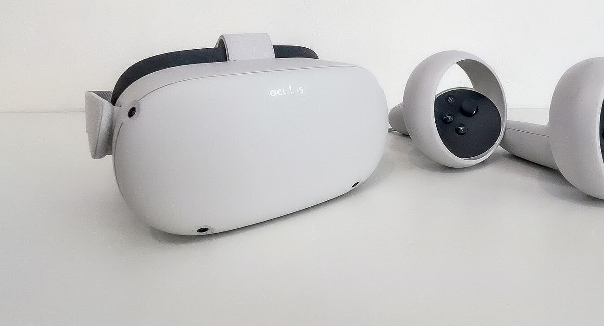{ .ateca-hero__img .off-glb }

AR / VR (gafas) · Aula ATECA

<h1>Apps VR gratuitas</h1>

Catálogo de aplicaciones gratuitas para Meta Quest organizadas por familia profesional, con enlace directo a la tienda.

Foto: <a href="https://commons.wikimedia.org/wiki/File:Oculus_Quest_II_(50844634326).jpg" target="_blank" rel="noopener">Maximilian Prandstätter</a> · CC BY 2.0 · Wikimedia Commons

<a class="video-boton" href="https://www.youtube.com/watch?v=b3EToKTc_Lo" target="_blank" rel="noopener" title="9 aplicaciones educativas para Meta Quest (Glassday)">Vídeo · 7 min9 aplicaciones educativas para Meta QuestGlassday</a>
<a class="video-boton" href="https://www.youtube.com/watch?v=zIt7Nke1A_M" target="_blank" rel="noopener" title="Las 17 mejores apps de VR gratis (Xataka)">Vídeo · 9 minLas 17 mejores apps de VR gratisXataka</a>
<a class="video-boton" href="https://www.youtube.com/watch?v=XqfaW2oK0AE" target="_blank" rel="noopener" title="10 apps gratis que no son juegos (El Rincón del Friki)">Vídeo · 6 min10 apps gratis que no son juegosEl Rincón del Friki</a>

Aplicaciones **gratuitas** para gafas **Meta Quest** (2/3/3S/Pro) agrupadas por familia profesional de FP, para que el profesorado vea de un vistazo qué experiencias puede probar en cada ciclo sin coste de licencia. Pulsa en el nombre para abrir la ficha de la app en la tienda de Meta. Cuando una app es *freemium* (base gratis y ampliaciones de pago) se indica en la descripción.

!!! warning "El catálogo cambia"
    En la tienda de Meta, apps gratuitas pasan a ser de pago (o al revés) y algunas se retiran sin aviso (por ejemplo, Horizon Workrooms se retiró en febrero de 2026). Antes de una sesión con alumnado, comprueba precio y disponibilidad desde el propio visor o en [meta.com/experiences](https://www.meta.com/experiences/){target="_blank"}.

!!! info "Una sola cuenta para las 6 gafas"
    Las apps de la tienda solo pueden abrirse en **una gafa a la vez** con la cuenta del centro. Para actividades con todo el grupo, mira las alternativas en [VR y AR en el aula](realidad-virtual-aumentada.md#que-podemos-usar-en-clase).

## Aplicaciones por familia { .seccion }

<table class="tabla-apps">
<thead><tr><th>Imagen</th><th>Aplicación</th><th>Descripción</th></tr></thead>
<tbody>
<tr class="tabla-apps__familia"><td colspan="3">Actividades Físicas y Deportivas</td></tr>
<tr><td class="tabla-apps__icono">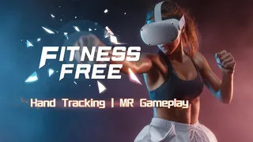</td><td class="tabla-apps__nombre"><a href="https://www.meta.com/es-es/experiences/fitness-free/6726707740760941/" target="_blank" rel="noopener">Fitness Free</a></td><td>Entrenamiento de boxeo en realidad mixta con seguimiento de manos, música rítmica y análisis de datos del entrenamiento; útil para trabajar condición física y coordinación en ciclos deportivos.</td></tr>
<tr><td class="tabla-apps__icono">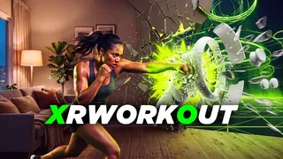</td><td class="tabla-apps__nombre"><a href="https://www.meta.com/es-es/experiences/xrworkout-free-to-play-vr-fitness-sport/8266372770101746/" target="_blank" rel="noopener">XRWorkout Free to Play</a></td><td>Fitness funcional de cuerpo completo sin mandos, con clases en directo y entrenamientos multijugador alrededor del mundo; sirve para diseñar rutinas grupales de acondicionamiento físico.</td></tr>
<tr><td class="tabla-apps__icono">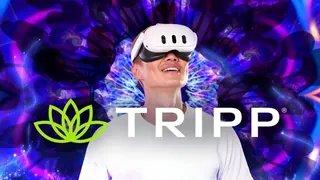</td><td class="tabla-apps__nombre"><a href="https://www.meta.com/es-es/experiences/tripp-meditation-relaxation-sleep/2173576192720129/" target="_blank" rel="noopener">Tripp</a></td><td>Plataforma de bienestar y mindfulness respaldada por investigación; útil para trabajar gestión del estrés y regulación emocional antes o después de la actividad física.</td></tr>
<tr><td class="tabla-apps__icono">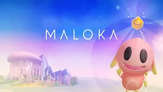</td><td class="tabla-apps__nombre"><a href="https://www.meta.com/es-es/experiences/maloka/4014704425248676/" target="_blank" rel="noopener">Maloka</a></td><td>Islas personales de meditación guiada con más de 100 sesiones de mindfulness, respiración y yoga impartidas por profesionales del bienestar.</td></tr>
<tr class="tabla-apps__familia"><td colspan="3">Administración y Gestión</td></tr>
<tr><td class="tabla-apps__icono">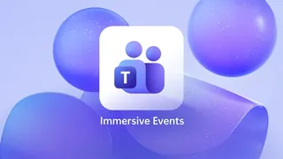</td><td class="tabla-apps__nombre"><a href="https://www.meta.com/es-es/experiences/microsoft-teams-immersive/25025465670425260/" target="_blank" rel="noopener">Microsoft Teams Immersive</a></td><td>Eventos y reuniones 3D personalizables integradas con el calendario de Teams; permite simular presentaciones corporativas y dinámicas de reuniones de empresa.</td></tr>
<tr><td class="tabla-apps__icono">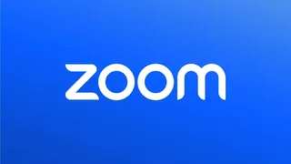</td><td class="tabla-apps__nombre"><a href="https://www.meta.com/es-es/experiences/zoom-workplace/8899655123384953/" target="_blank" rel="noopener">Zoom Workplace</a></td><td>Videoconferencias de Zoom con avatar dentro del visor, con modo passthrough para no perder de vista el aula; útil para simular atención telemática al cliente.</td></tr>
<tr><td class="tabla-apps__icono"></td><td class="tabla-apps__nombre">Microsoft Mesh <small>No aparece en la tienda (nov. 2026)</small></td><td>Espacios de colaboración 3D para equipos distribuidos, con pizarras y objetos compartidos; permite practicar dinámicas de trabajo en equipo y gestión de proyectos.</td></tr>
<tr><td class="tabla-apps__icono">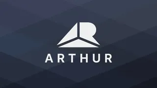</td><td class="tabla-apps__nombre"><a href="https://www.meta.com/es-es/experiences/arthur/2108767382537806/" target="_blank" rel="noopener">Arthur</a></td><td>Sala de trabajo colaborativo tipo &quot;chat room&quot; con pizarras, diagramas de flujo y archivos 3D compartidos (gratis 1 sala, hasta 10 personas).</td></tr>
<tr><td class="tabla-apps__icono">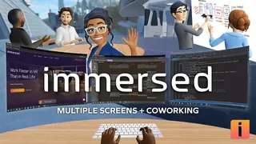</td><td class="tabla-apps__nombre"><a href="https://www.meta.com/es-es/experiences/immersed/2849273531812512/" target="_blank" rel="noopener">Immersed</a></td><td>Escritorio virtual con hasta 3 monitores para PC o Mac y colaboración con hasta 4 personas más; ideal para prácticas de ofimática avanzada.</td></tr>
<tr><td class="tabla-apps__icono">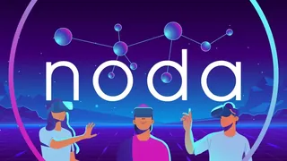</td><td class="tabla-apps__nombre"><a href="https://www.meta.com/es-es/experiences/noda/3916601848368970/" target="_blank" rel="noopener">Noda</a></td><td>App de productividad para lluvia de ideas y mapas mentales colaborativos; útil para planificación de proyectos y organización documental en el aula.</td></tr>
<tr><td class="tabla-apps__icono">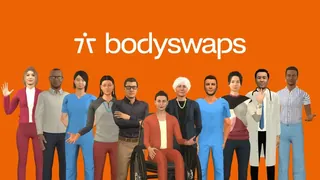</td><td class="tabla-apps__nombre"><a href="https://www.meta.com/es-es/experiences/bodyswaps-soft-skills-training/3714188128706579/" target="_blank" rel="noopener">Bodyswaps</a></td><td>Simulaciones inmersivas con IA para entrenar habilidades blandas: entrevistas de trabajo, feedback y gestión de conflictos en el entorno laboral.</td></tr>
<tr><td class="tabla-apps__icono">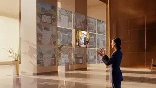</td><td class="tabla-apps__nombre"><a href="https://www.meta.com/es-es/experiences/talespin-for-business/4445544165507759/" target="_blank" rel="noopener">Talespin</a></td><td>Plataforma de contenidos de formación inmersiva ya preparados sobre gestión, liderazgo y procesos administrativos de empresa.</td></tr>
<tr><td class="tabla-apps__icono"></td><td class="tabla-apps__nombre">MeetinVR <small>No aparece en la tienda (nov. 2026)</small></td><td>Salas de juntas 3D para hasta 12 personas conectadas, con pizarras, pantallas compartidas y anotaciones; útil para simular reuniones de dirección.</td></tr>
<tr class="tabla-apps__familia"><td colspan="3">Agraria</td></tr>
<tr><td class="tabla-apps__icono">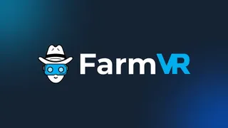</td><td class="tabla-apps__nombre"><a href="https://www.meta.com/es-es/experiences/farmvr/6286947614690392/" target="_blank" rel="noopener">FarmVR</a></td><td>Vídeos 360° grabados en granjas reales de Australia que muestran de dónde viene la comida; pensado para acercar al alumnado al sector agrario como salida profesional.</td></tr>
<tr><td class="tabla-apps__icono">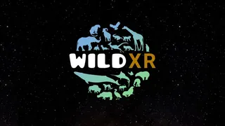</td><td class="tabla-apps__nombre"><a href="https://www.meta.com/es-es/experiences/wildxr/3634799699973926/" target="_blank" rel="noopener">WildXR</a></td><td>Aventura de observación de fauna salvaje a tu propio ritmo; útil para trabajar biodiversidad, manejo del entorno natural y bienestar animal.</td></tr>
<tr class="tabla-apps__familia"><td colspan="3">Energía y Agua</td></tr>
<tr><td class="tabla-apps__icono">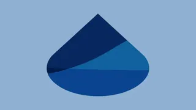</td><td class="tabla-apps__nombre"><a href="https://www.meta.com/es-es/experiences/agua-contigo-vr/5515707115197049/" target="_blank" rel="noopener">AGUA CONTIGO VR</a></td><td>Oficina virtual de la empresa Hidraqua atendida por agentes reales; permite simular gestiones y atención al cliente en el ciclo del agua.</td></tr>
<tr><td class="tabla-apps__icono">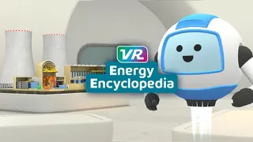</td><td class="tabla-apps__nombre"><a href="https://www.meta.com/es-es/experiences/energy-encyclopedia-vr/25876818165266366/" target="_blank" rel="noopener">Energy Encyclopedia VR</a></td><td>Extensión en RV de la enciclopedia online de energía, con contenidos sobre fusión, nuclear y renovables pensados para centros educativos.</td></tr>
<tr><td class="tabla-apps__icono">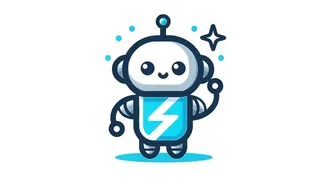</td><td class="tabla-apps__nombre"><a href="https://www.meta.com/es-es/experiences/electric-current/6760241874103169/" target="_blank" rel="noopener">Electric Current</a></td><td>Aplicación educativa que explica de forma visual e interactiva los fundamentos de la electricidad y la corriente eléctrica.</td></tr>
<tr class="tabla-apps__familia"><td colspan="3">Hostelería y Turismo</td></tr>
<tr><td class="tabla-apps__icono">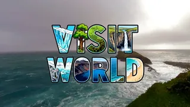</td><td class="tabla-apps__nombre"><a href="https://www.meta.com/es-es/experiences/visit-world/24958362107126414/" target="_blank" rel="noopener">Visit World</a></td><td>Demo gratuita con vídeos 360° en 3D de cinco destinos (Alaska, Madeira, Azores, Feroe, norte de España); sirve como introducción al turismo virtual.</td></tr>
<tr><td class="tabla-apps__icono">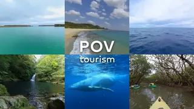</td><td class="tabla-apps__nombre"><a href="https://www.meta.com/es-es/experiences/pov-tourism/6329840140448140/" target="_blank" rel="noopener">POV Tourism</a></td><td>Vídeos 360° grabados simultáneamente con varias cámaras que permiten mover el punto de vista libremente por destinos turísticos reales.</td></tr>
<tr><td class="tabla-apps__icono">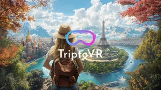</td><td class="tabla-apps__nombre"><a href="https://www.meta.com/es-es/experiences/triptovr-travel-the-world-explore-and-relax/6447684138675693/" target="_blank" rel="noopener">TriptoVR</a></td><td>Viajes virtuales a lugares icónicos (Venecia, Torre Eiffel, Tokio); incluye 2 destinos gratis sin registro y prueba de 7 días para el resto (freemium).</td></tr>
<tr><td class="tabla-apps__icono">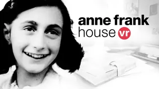</td><td class="tabla-apps__nombre"><a href="https://www.meta.com/es-es/experiences/anne-frank-house-vr/1958100334295482/" target="_blank" rel="noopener">Anne Frank House VR</a></td><td>Recorrido fiel por la Casa de Ana Frank en Ámsterdam; útil para trabajar patrimonio, turismo cultural e historia con sensibilidad.</td></tr>
<tr class="tabla-apps__familia"><td colspan="3">Informática y Comunicaciones</td></tr>
<tr><td class="tabla-apps__icono">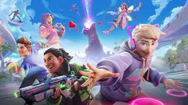</td><td class="tabla-apps__nombre"><a href="https://www.meta.com/es-es/experiences/worlds/2532035600194083/" target="_blank" rel="noopener">Horizon Worlds</a></td><td>Plataforma social de Meta para crear mundos virtuales sin programar; introduce al alumnado en el diseño de entornos y lógica básica de eventos.</td></tr>
<tr><td class="tabla-apps__icono">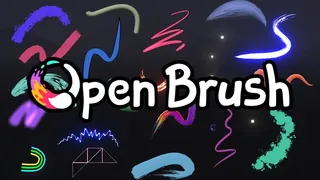</td><td class="tabla-apps__nombre"><a href="https://www.meta.com/es-es/experiences/open-brush-3d-painting/3600360710032222/" target="_blank" rel="noopener">Open Brush</a></td><td>Herramienta de pintura 3D de código abierto (continuación de Tilt Brush); útil para prototipado visual y diseño de interfaces inmersivas.</td></tr>
<tr><td class="tabla-apps__icono">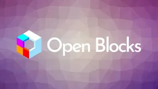</td><td class="tabla-apps__nombre"><a href="https://www.meta.com/es-es/experiences/open-blocks-low-poly-3d-modelling/8043509915705378/" target="_blank" rel="noopener">Open Blocks</a></td><td>Modelado 3D básico en RV sin experiencia previa; sirve como primer contacto con diseño 3D antes de pasar a Blender o similar.</td></tr>
<tr><td class="tabla-apps__icono">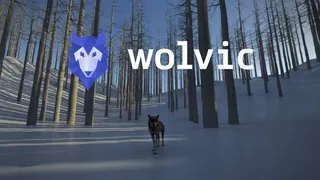</td><td class="tabla-apps__nombre"><a href="https://www.meta.com/es-es/experiences/wolvic/5917120145021341/" target="_blank" rel="noopener">Wolvic Browser</a></td><td>Navegador web independiente y de código abierto para visores XR; permite consultar documentación técnica y ver vídeo inmersivo desde el propio visor.</td></tr>
<tr><td class="tabla-apps__icono"></td><td class="tabla-apps__nombre">Microsoft Windows (Quest) <small>No aparece en la tienda (nov. 2026)</small></td><td>Extiende el escritorio de Windows 11 directamente al visor; útil para prácticas de sistemas operativos y ofimática en pantallas virtuales grandes.</td></tr>
<tr><td class="tabla-apps__icono">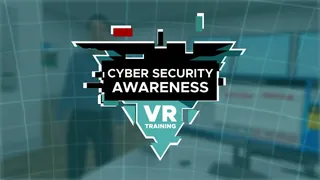</td><td class="tabla-apps__nombre"><a href="https://www.meta.com/es-es/experiences/cyber-security-awareness-training/24778025675145100/" target="_blank" rel="noopener">Cyber Security Awareness Training</a></td><td>Simulación en la que el usuario detecta amenazas y reporta riesgos de seguridad en un entorno de oficina; introduce conceptos de ciberseguridad.</td></tr>
<tr><td class="tabla-apps__icono">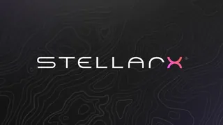</td><td class="tabla-apps__nombre"><a href="https://www.meta.com/es-es/experiences/stellarx/8132958546745663/" target="_blank" rel="noopener">StellarX</a></td><td>Plataforma sin código para crear experiencias de RV y RA, importando modelos 3D desde Sketchfab o Blender; ideal como primer proyecto de desarrollo.</td></tr>
<tr><td class="tabla-apps__icono">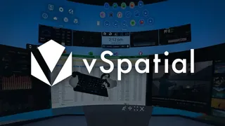</td><td class="tabla-apps__nombre"><a href="https://www.meta.com/es-es/experiences/vspatial/2540393919317658/" target="_blank" rel="noopener">vSpatial</a></td><td>Conexión remota segura a un PC con Windows y varios monitores virtuales por ventana; permite practicar administración de sistemas a distancia.</td></tr>
<tr><td class="tabla-apps__icono">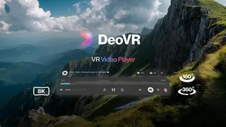</td><td class="tabla-apps__nombre"><a href="https://www.meta.com/es-es/experiences/deovr-vr-video-player/25289867110644741/" target="_blank" rel="noopener">DeoVR</a></td><td>Reproductor de vídeo 180°/360°/3D con streaming inalámbrico de archivos propios; útil para trabajar producción y consumo de contenido audiovisual inmersivo.</td></tr>
<tr class="tabla-apps__familia"><td colspan="3">Inglés</td></tr>
<tr><td class="tabla-apps__icono"></td><td class="tabla-apps__nombre">Curso de Inglés <small>No aparece en la tienda (nov. 2026)</small></td><td>50 lecciones con audio, texto y pronunciación en tres niveles (básico, intermedio, avanzado) más 5 exámenes de evaluación, todo en español/inglés.</td></tr>
<tr><td class="tabla-apps__icono">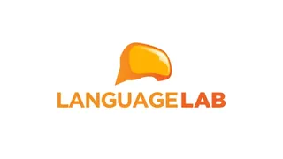</td><td class="tabla-apps__nombre"><a href="https://www.meta.com/es-es/experiences/language-lab/3802077353226534/" target="_blank" rel="noopener">Language Lab VR</a></td><td>Entornos realistas (ciudad, casa, supermercado, restaurante) donde se escuchan y practican nombres de objetos; incluye eventos gratuitos de intercambio de idiomas los miércoles.</td></tr>
<tr class="tabla-apps__familia"><td colspan="3">Madera, Mueble y Corcho</td></tr>
<tr><td class="tabla-apps__icono">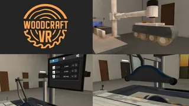</td><td class="tabla-apps__nombre"><a href="https://www.meta.com/es-es/experiences/woodcraft-vr/6056003204443381/" target="_blank" rel="noopener">Woodcraft VR</a></td><td>Simulación de sierra de panel y fresadora creada por HITLab (Howest University) para ciclos de FP de madera; entrena manejo de maquinaria sin riesgo.</td></tr>
<tr><td class="tabla-apps__icono">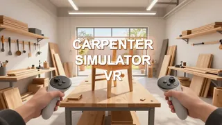</td><td class="tabla-apps__nombre"><a href="https://www.meta.com/es-es/experiences/carpenter-simulator-vr/9339242419455444/" target="_blank" rel="noopener">Carpenter Simulator VR</a></td><td>Construcción de muebles reales siguiendo planos: medir, cortar, taladrar y atornillar; disponible para probar gratis en Meta Horizon Store.</td></tr>
<tr><td class="tabla-apps__icono">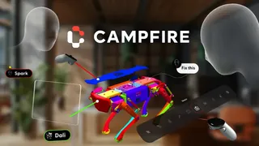</td><td class="tabla-apps__nombre"><a href="https://www.meta.com/es-es/experiences/campfire/6927340777330402/" target="_blank" rel="noopener">Campfire 3D</a></td><td>Herramienta para comunicar información 3D a lo largo del ciclo de vida de un producto; útil para revisar diseños de mobiliario en equipo.</td></tr>
<tr class="tabla-apps__familia"><td colspan="3">Sanidad</td></tr>
<tr><td class="tabla-apps__icono">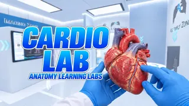</td><td class="tabla-apps__nombre"><a href="https://www.meta.com/es-es/experiences/anatomy-learning-labs-cardio-lab/25009704535306121/" target="_blank" rel="noopener">Anatomy Learning Labs</a></td><td>Exploración del cuerpo humano a nivel de órgano, tejido y célula con imagen médica e interactividad; el sistema cardiovascular está incluido en la versión gratuita.</td></tr>
<tr><td class="tabla-apps__icono">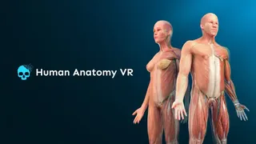</td><td class="tabla-apps__nombre"><a href="https://www.meta.com/es-es/experiences/human-anatomy-vr/6643334382420936/" target="_blank" rel="noopener">Human Anatomy VR</a></td><td>Herramienta anatómica en RV muy detallada, usada y validada por universidades; apta para prácticas de anatomía en ciclos sanitarios.</td></tr>
<tr><td class="tabla-apps__icono">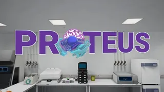</td><td class="tabla-apps__nombre"><a href="https://www.meta.com/es-es/experiences/proteus/5757341224329026/" target="_blank" rel="noopener">Proteus</a></td><td>App de aprendizaje que introduce al alumnado en terapias celulares y génicas avanzadas mediante visualización interactiva en RV.</td></tr>
<tr><td class="tabla-apps__icono">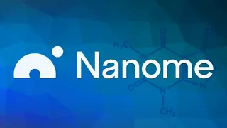</td><td class="tabla-apps__nombre"><a href="https://www.meta.com/es-es/experiences/nanome/2038368596280231/" target="_blank" rel="noopener">Nanome</a></td><td>Interfaz de descubrimiento científico usada por estudiantes de química y biología para visualizar y manipular moléculas en 3D.</td></tr>
<tr><td class="tabla-apps__icono">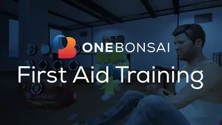</td><td class="tabla-apps__nombre"><a href="https://www.meta.com/es-es/experiences/first-aid-training/6362574740446363/" target="_blank" rel="noopener">First Aid Training</a></td><td>Simulaciones realistas de primeros auxilios ante emergencias: analizar la situación, reaccionar correctamente y controlar el origen del peligro.</td></tr>
<tr><td class="tabla-apps__icono">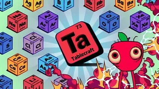</td><td class="tabla-apps__nombre"><a href="https://www.meta.com/es-es/experiences/tablecraft/3106826269327475/" target="_blank" rel="noopener">Tablecraft</a></td><td>Sandbox científico de química en RV donde se experimenta con átomos y se redescubre la tabla periódica de forma manipulativa.</td></tr>
<tr class="tabla-apps__familia"><td colspan="3">Seguridad y Medio Ambiente</td></tr>
<tr><td class="tabla-apps__icono">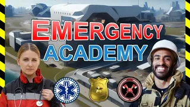</td><td class="tabla-apps__nombre"><a href="https://www.meta.com/es-es/experiences/emergency-academy/6589399587789722/" target="_blank" rel="noopener">Emergency Academy</a></td><td>Formación en extinción de incendios con módulo gratuito de &quot;Fire Extinguisher Training&quot;; módulos adicionales son de pago único.</td></tr>
<tr><td class="tabla-apps__icono">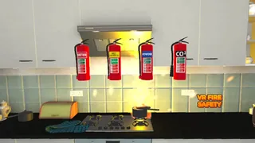</td><td class="tabla-apps__nombre"><a href="https://www.meta.com/es-es/experiences/vr-fire-safety/8808762005913851/" target="_blank" rel="noopener">VR Fire Safety</a></td><td>Entrenamiento inmersivo con módulos sobre el triángulo del fuego, identificación de riesgos y uso correcto de extintores.</td></tr>
<tr><td class="tabla-apps__icono">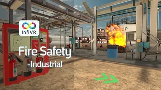</td><td class="tabla-apps__nombre"><a href="https://www.meta.com/es-es/experiences/fire-safety-industrial/30308532272125993/" target="_blank" rel="noopener">Fire Safety - Industrial</a></td><td>Exploración de plantas industriales virtuales para localizar salidas de emergencia y practicar el uso de extintores en un entorno realista.</td></tr>
<tr class="tabla-apps__familia"><td colspan="3">Servicios Socioculturales y a la Comunidad</td></tr>
<tr><td class="tabla-apps__icono"></td><td class="tabla-apps__nombre">MUVA (Museo Virtual de Arte) <small>No aparece en la tienda (nov. 2026)</small></td><td>Exposiciones de arte totalmente gratuitas y accesibles (Rembrandt, Grandes Civilizaciones, Impresión); pensado para que cualquier colectivo acceda a la cultura sin barreras.</td></tr>
<tr><td class="tabla-apps__icono">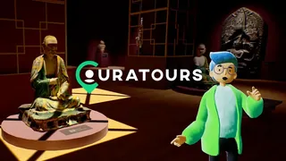</td><td class="tabla-apps__nombre"><a href="https://www.meta.com/es-es/experiences/curatours/4563712077031603/" target="_blank" rel="noopener">Curatours</a></td><td>Plataforma social de tours culturales y patrimoniales guiados o autoguiados; permite visitar espacios de arte en grupo con otras personas conectadas.</td></tr>
<tr><td class="tabla-apps__icono">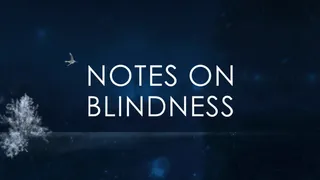</td><td class="tabla-apps__nombre"><a href="https://www.meta.com/es-es/experiences/notes-on-blindness/1946326588770583/" target="_blank" rel="noopener">Notes on Blindness</a></td><td>Experiencia narrativa que traslada al usuario a un mundo más allá de la vista; muy útil para trabajar empatía y sensibilización en discapacidad visual.</td></tr>
<tr><td class="tabla-apps__icono">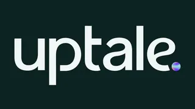</td><td class="tabla-apps__nombre"><a href="https://www.meta.com/es-es/experiences/uptale/3963519810378273/" target="_blank" rel="noopener">Uptale</a></td><td>Permite crear y compartir experiencias inmersivas a partir de capturas 360°, pensada para centros y entidades sociales sin conocimientos técnicos.</td></tr>
<tr><td class="tabla-apps__icono">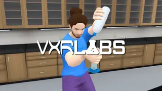</td><td class="tabla-apps__nombre"><a href="https://www.meta.com/es-es/experiences/vxrlabs-by-victoryxr/6140788979300821/" target="_blank" rel="noopener">Victory XR</a></td><td>Plataforma de aprendizaje espacial en 3D con contenidos variados; útil para proyectos de intervención comunitaria y educación no formal.</td></tr>
<tr><td class="tabla-apps__icono">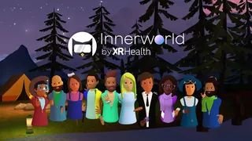</td><td class="tabla-apps__nombre"><a href="https://www.meta.com/es-es/experiences/innerworld-by-xrhealth/5406767536033508/" target="_blank" rel="noopener">Innerworld</a></td><td>Comunidad anónima y segura con herramientas de salud mental basadas en evidencia, grupos de apoyo y sesiones guiadas; útil para proyectos de intervención social.</td></tr>
</tbody>
</table>

## Notas por familia { .seccion }

- **Actividades Físicas y Deportivas**: usar en sesiones cortas (10-15 min) por el esfuerzo físico y el riesgo de mareo; despejar bien el área de juego (Guardian).
- **Administración y Gestión**: muy útil para simular reuniones, atención al cliente y procesos de selección (Bodyswaps) sin depender de una sala física.
- **Agraria**: el catálogo gratuito es aún reducido; complementar con los simuladores de pago de [VRFP](https://vrfp.es/familias-profesionales/todas-familias-profesionales/){target="_blank"} si el presupuesto lo permite.
- **Energía y Agua**: combinar con visitas virtuales de empresas del sector (AGUA CONTIGO VR) para acercar el mundo laboral real al aula.
- **Hostelería y Turismo**: los vídeos 360° funcionan bien como "excursión virtual" previa a una FCT o viaje de estudios.
- **Informática y Comunicaciones**: Horizon Worlds y Open Blocks son una buena puerta de entrada al diseño 3D antes de herramientas profesionales como Unity o Blender.
- **Inglés**: aprovechar los eventos de intercambio de idiomas en directo de Language Lab VR para practicar conversación real, no solo vocabulario.
- **Madera, Mueble y Corcho**: Woodcraft VR y Carpenter Simulator VR permiten repetir el mismo corte o ensamblaje tantas veces como haga falta sin gastar material.
- **Sanidad**: revisar el nivel de detalle anatómico de cada app antes de usarla con un grupo, ya que varía mucho de una a otra.
- **Seguridad y Medio Ambiente**: ideal para simulacros de incendio o evacuación que serían imposibles o peligrosos de reproducir en el centro.
- **Servicios Socioculturales y a la Comunidad**: MUVA y Curatours son accesibles para cualquier colectivo, incluidos proyectos de inclusión y mayores; Innerworld requiere supervisión docente por tratar temas de salud mental.

## Cómo se seleccionaron { .seccion }

Para cada app se ha comprobado, mediante búsquedas y fichas oficiales de Meta Horizon Store (julio de 2026), que el precio mostrado era **0 €** o que el propio desarrollador la describe como "free"/"gratis". Se han descartado apps con precio confirmado (por ejemplo *Farming Simulator VR*, *Across the Valley*, *ArtQuest VR* o *Cooking Simulator VR*, todas de pago) y apps solo disponibles como prueba temporal (*MEDICALHOLODECK*, con 7 días de prueba gratuita). Cuando el modelo es freemium se indica explícitamente en la descripción (ver *TriptoVR*).

No se incluyen apps que dependan de una suscripción Meta Horizon+ para acceder a su contenido, ni apps que en el momento de escribir esto ya estaban anunciadas como descontinuadas (caso de *Horizon Workrooms*, retirada el 16 de febrero de 2026).

## Próximos pasos { .seccion }

- **Agraria** y **Madera, Mueble y Corcho** son las familias con menos oferta gratuita real; valorar solicitar acceso de evaluación a los simuladores de pago de [VRFP](https://vrfp.es/familias-profesionales/todas-familias-profesionales/){target="_blank"} para esos ciclos.
- Revisar trimestralmente Meta Horizon Store y SideQuest App Lab: se publican apps nuevas de forma constante y algunas gratuitas actuales podrían cambiar de modelo de precio.
- Documentar en este mismo archivo, a modo de tabla de cambios al final, cualquier app que deje de ser gratuita o se retire de la tienda.

## Recursos { .seccion }

- 🌐 [Meta Horizon Store](https://www.meta.com/experiences/){target="_blank"} – catálogo oficial de apps para Meta Quest.
- 🧩 [SideQuest VR](https://sidequestvr.com/){target="_blank"} – apps experimentales y en fase App Lab.
- 🎓 [VRFP – Familias Profesionales](https://vrfp.es/familias-profesionales/todas-familias-profesionales/){target="_blank"} – simuladores de RV organizados por familia profesional.
- 🧯 [Simuladores VR para FP – Aulas ATECA](https://aulasateca.com/simuladores-de-realidad-virtual-para-fp/){target="_blank"}
- 📖 Documento relacionado del propio Aula ATECA: [Realidad Virtual (VR) y Realidad Aumentada (AR)](realidad-virtual-aumentada.md).

> 🔄 **Última comprobación de precios:** julio de 2026. **Imágenes y enlaces a la tienda:** noviembre de 2026. Revisar de nuevo antes de cada curso escolar.
