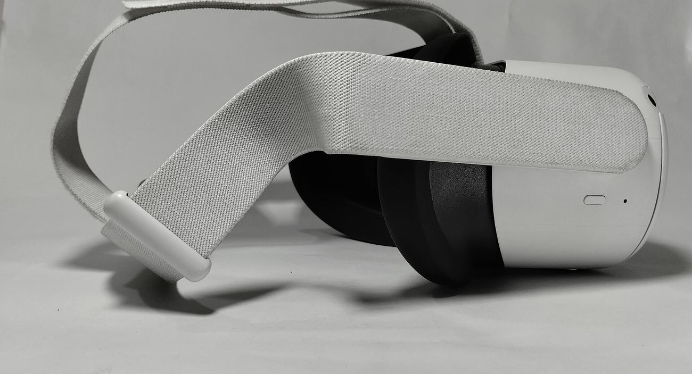
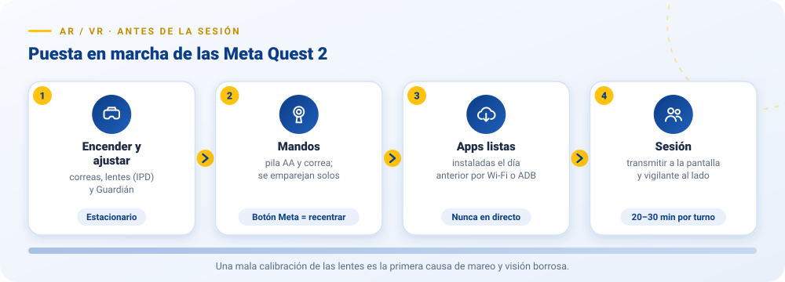

<div class="ateca-hero" markdown>

{ .ateca-hero__img .off-glb }

<div class="ateca-hero__texto">
<p class="ateca-hero__eyebrow">AR / VR (gafas) · Aula ATECA</p>
<h1>Gafas <span>Meta Quest 2</span></h1>
<p>Manual de uso, mantenimiento y gestión de las 6 gafas del aula: del primer encendido a instalar apps en todas a la vez.</p>
</div>
<p class="ateca-hero__credito">Foto: <a href="https://commons.wikimedia.org/wiki/File:Meta_quest_2_2.jpg" target="_blank" rel="noopener">Wasiul Bahar</a> · CC BY-SA 4.0 · Wikimedia Commons</p>

</div>

<div class="video-botones">
<a class="video-boton" href="https://www.youtube.com/watch?v=axuMgYROu2g" target="_blank" rel="noopener" title="Primeros pasos con las Quest 2 (elpolivirtual)"><span class="video-boton__play"></span><span class="video-boton__texto"><span class="video-boton__meta">Vídeo · 3 min</span><span class="video-boton__titulo">Primeros pasos con las Quest 2</span><span class="video-boton__canal">elpolivirtual</span></span></a>
<a class="video-boton" href="https://www.youtube.com/watch?v=wMUlDf8puUk" target="_blank" rel="noopener" title="Activar el modo desarrollador (2026) (Sicofire)"><span class="video-boton__play"></span><span class="video-boton__texto"><span class="video-boton__meta">Vídeo · 2 min</span><span class="video-boton__titulo">Activar el modo desarrollador (2026)</span><span class="video-boton__canal">Sicofire</span></span></a>
<a class="video-boton" href="https://www.youtube.com/watch?v=GiI7ccDB6Mw" target="_blank" rel="noopener" title="Instalar SideQuest y aplicaciones APK (NEXT Manu)"><span class="video-boton__play"></span><span class="video-boton__texto"><span class="video-boton__meta">Vídeo · 8 min</span><span class="video-boton__titulo">Instalar SideQuest y aplicaciones APK</span><span class="video-boton__canal">NEXT Manu</span></span></a>
</div>


!!! info "OBJETIVOS"
    Este manual explica cómo **sacar, montar, usar, actualizar y devolver a la caja** las 6 gafas **Meta Quest 2** del aula (`Q2-01` … `Q2-06`), y cómo se gestionan durante el curso 2026-27: **una cuenta Meta del centro**, **modo desarrollador** e instalación de apps con **ADB**.

    Para instalar el simulador de aerogeneradores, consulta [SimulWind en Quest 2](simulwind.md). Para saber qué contenidos usar en clase, [VR y AR en el aula](realidad-virtual-aumentada.md).

!!! info "RECURSOS"
    - Caja con las gafas **Meta Quest 2** numeradas, sus dos mandos **Touch** y el cargador.
    - Cuenta Meta del centro y la app **Meta Horizon** en el móvil del profesorado.
    - Un PC con **ADB** (Android Platform Tools) y, opcionalmente, **SideQuest**.
    - Un **hub USB** con alimentación y cables **USB-C de datos**, o Wi-Fi en la misma red que el PC.

## Uso diario { .seccion }

{ .diagrama .off-glb }

### 1. Contenido de la caja

Antes de empezar, comprueba que la caja está completa. Al terminar, la caja debe quedar **igual que la encontraste**.

| Elemento | Cantidad | Comprobación |
|---|:---:|---|
| Visor Meta Quest 2 | 1 | Lentes limpias y sin arañazos |
| Mando Touch izquierdo y derecho | 2 | Con pila AA y la correa de muñeca puesta |
| Cargador y cable USB-C | 1 | Sin dobleces ni conectores dañados |
| Separador para gafas graduadas | 1 | Puede venir colocado en el visor |
| Interfaz facial (espuma o silicona) | 1 | Limpia y bien encajada |

!!! warning "Cuidado con el sol"
    **Nunca** dejes las gafas con las lentes al sol, ni siquiera junto a una ventana. Las lentes concentran la luz y pueden **quemar la pantalla** en pocos segundos. Guárdalas siempre en la caja o boca abajo.

### 2. Puesta en marcha

**2.1 Carga**: la batería dura unas **2 horas**. Conecta el visor al cargador hasta que el LED frontal se ponga **verde**. Rojo o naranja significa que está cargando.

**2.2 Encendido**: mantén pulsado el **botón de encendido** (lateral derecho) unos 3 segundos hasta oír el sonido de arranque. Para apagar, mantén pulsado el mismo botón y elige **Apagar**.

**2.3 Ajuste al usuario**:

- Afloja las correas laterales y la superior, colócate el visor de **delante hacia atrás** y ajusta las correas hasta que quede firme sin apretar.
- Ajusta la **distancia entre lentes (IPD)** moviendo las lentes con los dedos por el borde exterior. Hay tres posiciones (58, 63 y 68 mm). Elige la que te dé la imagen más nítida: una mala calibración es la primera causa de mareo o visión borrosa.
- Si usas gafas graduadas, coloca el **separador** entre la interfaz facial y el visor.

**2.4 Mandos**: retira la lengüeta de plástico de las pilas si es la primera vez. Se encienden solos al pulsar cualquier botón.

| Botón | Mando | Función |
|---|---|---|
| **Meta** (logotipo) | Derecho | Abre el menú principal. Mantenido: **recentra** la vista |
| **Menú** (≡) | Izquierdo | Menú de la aplicación |
| **Gatillo** (índice) | Ambos | Seleccionar / pulsar |
| **Agarre** (lateral) | Ambos | Coger objetos |
| **A / B · X / Y** | Der. / Izq. | Acciones de cada aplicación |
| **Joystick** | Ambos | Moverse y desplazarse por menús |

### 3. Guardián y funciones

**3.1 Cuenta**: las gafas ya están vinculadas a la **cuenta Meta del centro**. **No** inicies sesión con tu cuenta personal ni cambies la cuenta. Si un visor está restablecido de fábrica, avisa al profesorado, que lo emparejará con la app **Meta Horizon**.

**3.2 Guardián (límite de juego)**: al ponerte las gafas, el sistema pide definir la zona segura.

- **Estacionario**: para usar las apps **sentado o de pie sin desplazarte**. Es la opción recomendada en el aula.
- **Escala de sala**: dibuja con el mando el perímetro de un espacio libre de al menos **2 × 2 m**. Repítelo cada vez que cambie la disposición del mobiliario.

Revisa que el **suelo** aparezca a la altura correcta. Si no, ajústalo en el asistente antes de continuar.

**3.3 Funciones útiles en clase**:

- **Transmitir (casting)**: desde *Cámara → Transmitir* envía lo que ves a la pantalla del aula, al PC o al móvil (`oculus.com/casting`). Así el resto del grupo sigue la práctica.
- **Passthrough**: doble toque en el lateral del visor para ver el aula sin quitarte las gafas.
- **Capturas**: pulsa **Meta + gatillo** a la vez. Sirven de evidencia para la práctica.
- **Seguimiento de manos**: si dejas los mandos, el visor reconoce tus manos. Para simuladores usa **siempre los mandos**.

## Mantenimiento { .seccion }

### 4. Actualizar el sistema

Las actualizaciones corrigen errores y son **imprescindibles** para que Quest Link funcione con la última versión de la app del PC.

1. Carga el visor por encima del **50 %** y déjalo conectado al cargador.
2. Conéctalo a la **Wi-Fi del centro**.
3. Abre **Ajustes rápidos** (pulsa sobre el reloj en la barra universal) → **Ajustes** → **Sistema** → **Actualización de software**.
4. Si aparece una versión nueva, pulsa **Descargar** e **Instalar**. El visor se reiniciará.
5. Anota la versión instalada en la [hoja de control](#13-hoja-de-control).

!!! tip "Si no aparece ninguna actualización"
    Meta publica las actualizaciones de forma escalonada. Si un visor se queda atrás, déjalo encendido, cargando y conectado a la Wi-Fi durante la noche: normalmente se actualiza solo.

### 5. Mandos y aplicaciones

**5.1 Mandos**: se actualizan solos al estar emparejados con un visor actualizado. Comprueba su estado en **Ajustes → Dispositivos → Mandos**.

**5.2 Aplicaciones de la tienda**: **Biblioteca** (icono de cuadrícula) → **Actualizaciones** → **Actualizar todo**.

**5.3 App del PC**: **Meta Quest Link** (*Meta Horizon Link* en versiones recientes) se actualiza sola al arrancar. Si se queda atascada, reiníciala.

**5.4 APK**: las instaladas a mano **no se actualizan solas**. Cuando salga una versión nueva, vuelve a ejecutar el [script de instalación](#8-apk-en-las-6-gafas).

## Gestión del aula { .seccion }

### 6. Una sola cuenta del centro

| Opción | Resultado |
|---|---|
| **HMS + MDM** (gestión centralizada de Meta) | ❌ No sirve: Meta solo da HMS a Quest 3 y 3S, y desde 2025 ningún MDM puede gestionar gafas Quest sin HMS |
| **Una cuenta por gafa** | ⚠️ Posible, pero 6 cuentas que verificar y mantener, y las apps de pago se compran 6 veces |
| **Una cuenta del centro + APK y WebXR** | ✅ Opción elegida: sencilla, gratuita y las APK funcionan en las 6 gafas a la vez |

La contrapartida es que una app de la **tienda de Meta** solo puede abrirse en **una gafa a la vez**. Qué contenidos sí funcionan en todas está en [VR y AR en el aula](realidad-virtual-aumentada.md).

### 7. Modo desarrollador

Es lo que permite instalar APK y usar ADB. Se prepara **una sola vez**.

**7.1 Cuenta de desarrollador del centro**: la cuenta Meta del centro tiene que pertenecer a una **organización de desarrollador verificada**.

1. Entra en [developers.meta.com](https://developers.meta.com/){target="_blank"} con la **cuenta del centro**.
2. **Crea una organización** (por ejemplo, `CIFP Villa de Agüimes - ATECA`).
3. **Verifica la cuenta** con un **móvil (SMS)** o una **tarjeta de pago** (PayPal no sirve).

!!! tip "Evita usar un número personal"
    Si hay que verificar de nuevo, usa un medio del centro. No borres el método de verificación: si se elimina, el modo desarrollador puede desactivarse.

**7.2 Activarlo en cada gafa**:

1. Enciende la gafa y abre la app **Meta Horizon** en el móvil (con la cuenta del centro).
2. Toca el **icono de las gafas** → elige la gafa → **Ajustes del visor** → **Modo desarrollador** → **Activar**.
3. **Reinicia** la gafa.
4. Conéctala al PC por USB y, dentro de la gafa, acepta **Permitir depuración USB** marcando **Permitir siempre desde este ordenador**.

**7.3 Instalar ADB en el PC**:

1. Descarga **Android SDK Platform-Tools** de la [web oficial de Android](https://developer.android.com/tools/releases/platform-tools){target="_blank"}.
2. Descomprime la carpeta, por ejemplo en `C:\platform-tools`, y añádela al **PATH** de Windows.
3. Abre **PowerShell** y comprueba con `adb version`.

!!! success "Comprobación"
    Con las 6 gafas conectadas, este comando debe mostrar **6 líneas** terminadas en `device`:

    ```powershell
    adb devices
    ```

    Si alguna aparece como `unauthorized`, ponte esa gafa y acepta la depuración USB.

### 8. APK en las 6 gafas

Guarda este script como `C:\APK\instalar-apk.ps1`:

```powershell
# Instala una APK en todas las gafas conectadas por ADB
param([Parameter(Mandatory=$true)][string]$Apk)

$gafas = adb devices | Select-String "`tdevice$" | ForEach-Object { ($_ -split "`t")[0] }
Write-Host "Gafas detectadas: $($gafas.Count)"

foreach ($id in $gafas) {
    Write-Host "Instalando en $id..."
    adb -s $id install -r -g $Apk
}
```

Uso:

```powershell
cd C:\APK
.\instalar-apk.ps1 -Apk ".\mi-app.apk"
```

| Opción | Significado |
|---|---|
| `-r` | Reinstala o actualiza si la app ya existe |
| `-g` | Concede los permisos de la app al instalar |

!!! note "Si PowerShell bloquea el script"
    Ejecuta una vez `Set-ExecutionPolicy -Scope CurrentUser RemoteSigned`.

**Dónde encontrar la app en la gafa:** *Biblioteca* → filtro **Orígenes desconocidos**.

**Normas para las APK**:

- Descarga **solo de fuentes fiables** (web del desarrollador, itch.io, GitHub).
- Revisa la **licencia**: que una app sea gratuita no siempre permite usarla en varias gafas de un centro.
- Guarda las APK aprobadas en una carpeta del centro, por ejemplo `APK/nombre-app/version.apk`.
- Las gafas no tienen servicios de Google Play: las APK de móvil que dependen de ellos no funcionan.

### 9. Comandos ADB

| Tarea | Comando |
|---|---|
| Ver gafas conectadas | `adb devices` |
| Listar apps instaladas por el centro | `adb -s ID shell pm list packages -3` |
| Desinstalar una app | `adb -s ID uninstall nombre.del.paquete` |
| Copiar un vídeo 360° | `adb -s ID push video.mp4 /sdcard/Movies/` |
| Ver la batería | `adb -s ID shell dumpsys battery` |
| Reiniciar la gafa | `adb -s ID reboot` |

Sustituye `ID` por el identificador que aparece en `adb devices`.

### 10. ADB sin cables

Útil para actualizar las gafas sin moverlas de la estantería de carga.

1. Con la gafa conectada por USB: `adb -s ID tcpip 5555`
2. Mira la IP de la gafa en *Ajustes → Wi-Fi → red conectada*.
3. Desconecta el cable y ejecuta: `adb connect IP_DE_LA_GAFA:5555`
4. Al reiniciar la gafa hay que repetir el paso 1.

!!! warning "Misma red"
    El PC y las gafas deben estar en la **misma red Wi-Fi** y la red del centro debe permitir la conexión entre equipos.

### 11. SideQuest y WebXR

**SideQuest** es un programa para PC que instala APK arrastrándolas a su ventana, gafa por gafa. Es cómodo para probar una app; para las 6 gafas es más rápido el script del apartado 8.

**Experiencias web (WebXR)**: abre el **navegador** de las gafas, escribe la dirección (o ábrela desde un marcador) y pulsa **Entrar en realidad virtual**. Prepara una página con los enlaces de la clase para que el alumnado no tenga que escribir direcciones largas.

## Control y devolución { .seccion }

### 12. Antes y después de clase

| Antes de clase | Después de clase |
|---|---|
| Gafas cargadas (LED verde) | Gafas **en la caja o boca abajo**, nunca al sol |
| `adb devices` muestra las 6 gafas | Cerrar las apps abiertas |
| App de la sesión instalada en todas | Limpiar lentes e interfaz facial |
| Wi-Fi conectada | Poner a cargar |
| Probar la app en una gafa | Anotar incidencias en la hoja de control |

### 13. Hoja de control

Se guarda impresa dentro de la caja y se rellena cada vez que se actualizan o preparan las gafas.

| Visor | N.º de serie | Modo desarrollador | Versión de sistema | Mandos OK | Apps instaladas | Fecha | Responsable |
|---|---|:---:|---|:---:|---|---|---|
| Q2-01 | | ☐ | | ☐ | | | |
| Q2-02 | | ☐ | | ☐ | | | |
| Q2-03 | | ☐ | | ☐ | | | |
| Q2-04 | | ☐ | | ☐ | | | |
| Q2-05 | | ☐ | | ☐ | | | |
| Q2-06 | | ☐ | | ☐ | | | |

### 14. Seguridad y limpieza

**Uso seguro**:

- Sesiones de **20–30 minutos** como máximo, con descanso de al menos 10 minutos.
- Si notas **mareo, dolor de cabeza o fatiga visual**, quítate las gafas y siéntate. Avisa al profesorado.
- Un compañero o compañera hace de **vigilante** mientras otra persona lleva las gafas.
- No se recomienda su uso a menores de 13 años ni a personas con epilepsia fotosensible.

**Limpieza**:

- **Lentes**: solo con la **gamuza de microfibra seca**, con movimientos circulares desde el centro. Nada de líquidos, alcohol ni papel.
- **Interfaz facial y mandos**: toallita húmeda sin alcohol después de cada persona.

### 15. Devolución a la caja

- [ ] Gafas apagadas (no en reposo) y cargadas o puestas a cargar.
- [ ] Mandos con la correa recogida y sin pilas sueltas en la caja.
- [ ] Lentes limpias y protegidas, **sin luz solar directa**.
- [ ] Cable USB-C y cargador recogidos sin doblar.
- [ ] Hoja de control actualizada.

## Problemas frecuentes { .seccion }

| Problema | Solución |
|---|---|
| La imagen se ve borrosa | Ajusta la distancia entre lentes y la altura del visor. Limpia las lentes |
| La vista no está centrada | Mantén pulsado el botón **Meta** del mando derecho |
| Un mando no responde | Cambia la pila AA. Si sigue igual, reemparéjalo en **Ajustes → Dispositivos** |
| El Guardián aparece constantemente | Vuelve a crear el límite en un espacio con buena iluminación |

??? question "No aparece la opción Modo desarrollador en la app Meta Horizon"
    La cuenta no está en una organización de desarrollador o no está verificada. Revísalo en developers.meta.com.

??? question "La gafa aparece como unauthorized en adb devices"
    Ponte la gafa y acepta **Permitir depuración USB**. Si no aparece el aviso, desconecta y vuelve a conectar el cable.

??? question "La gafa no aparece en adb devices"
    Usa un cable USB-C **de datos** (no solo de carga), prueba otro puerto del hub y comprueba que el modo desarrollador sigue activo.

??? question "La app dice que no puede usarse en varios dispositivos a la vez"
    Es una app de la tienda de Meta con la misma cuenta en varias gafas. Usa una APK o una alternativa web, o una cuenta separada para esa actividad.

??? question "La APK se instala pero se cierra al abrirla"
    Puede depender de Google Play, no ser compatible con Quest 2 o ser antigua. Prueba la última versión del desarrollador.

??? question "El modo desarrollador se ha desactivado solo"
    Suele ocurrir si se borra el método de verificación de la cuenta. Vuelve a verificarla y actívalo de nuevo.

## Fuentes { .seccion }

- [Configuración oficial de Meta Quest](https://www.meta.com/quest/setup/){target="_blank"} y [soporte de Meta Quest](https://www.meta.com/help/quest/){target="_blank"}
- [Meta Developers – Activar el modo desarrollador](https://developers.meta.com/horizon/documentation/android-apps/enable-developer-mode/){target="_blank"}
- [Meta Developers – Configuración de dispositivos Quest](https://developers.meta.com/vr/documentation/native/android/mobile-device-setup-quest/){target="_blank"}
- [Android Developers – Android Debug Bridge (ADB)](https://developer.android.com/tools/adb){target="_blank"}
- [ManageXR – Integración con HMS (MDM solo mediante HMS)](https://help.managexr.com/en/articles/10518345-quick-start-integrating-managexr-with-meta-horizon-managed-services){target="_blank"}
