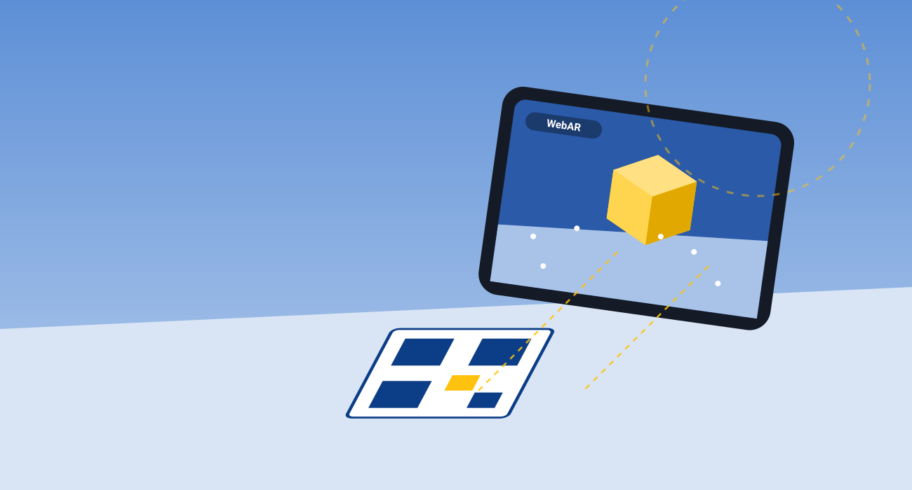

{ .ateca-hero__img .off-glb }

AR / VR (gafas) · Aula ATECA

<h1>Onirix Studio</h1>

Crea experiencias de realidad aumentada sin programar y compártelas con un enlace o un QR: se abren en el navegador del móvil, sin instalar nada.

<a class="video-boton" href="https://www.youtube.com/watch?v=0Uzo5L-7cGw" target="_blank" rel="noopener" title="Primeros pasos en Onirix Studio (Onirix)">Vídeo · 6 minPrimeros pasos en Onirix StudioOnirix</a>
<a class="video-boton" href="https://www.youtube.com/watch?v=fsCQ1xBhez0" target="_blank" rel="noopener" title="Tu primera experiencia con image tracking (Onirix)">Vídeo · 1 min · inglésTu primera experiencia con image trackingOnirix</a>
<a class="video-boton" href="https://www.youtube.com/watch?v=225Ub-BmGK4" target="_blank" rel="noopener" title="Tu primera experiencia sobre superficies (Onirix)">Vídeo · 1 min · inglésTu primera experiencia sobre superficiesOnirix</a>

**Onirix** es una plataforma española de **realidad aumentada en el navegador (WebAR)**. Desde **Onirix Studio**, una aplicación web, se monta la escena arrastrando modelos 3D, vídeos, imágenes y textos, y se publica con un enlace. Quien la abre desde el móvil o la tablet ve el contenido superpuesto a la cámara **sin instalar ninguna app**. Para quien quiera ir más allá, tiene un editor de código (HTML, CSS y JavaScript) y un SDK.

Es una herramienta muy adecuada para FP porque el alumnado **no solo consume AR: la crea**. Un ciclo de Mantenimiento puede añadir instrucciones flotantes a una máquina; uno de Turismo, una ruta con contenido en cada parada; uno de Sanidad, una lámina de anatomía que muestra el órgano en 3D al enfocarla.

## Cómo funciona { .seccion }

| Pieza | Qué es | Dónde se usa |
|---|---|---|
| **Onirix Studio** | Editor web para crear y publicar las experiencias | En el PC, desde el navegador |
| **Onirix Player** | El visor que abre la experiencia | En el navegador del móvil o la tablet (también hay app) |
| **Constructor** | App para escanear un espacio real | En el móvil, solo para *spatial tracking* |

Cada experiencia se ancla a algo que la cámara reconoce:

- **Image tracking**: una imagen o cartel. Es lo más fiable para empezar en clase.
- **Surface tracking**: una superficie plana, como una mesa o el suelo.
- **Spatial tracking**: un espacio escaneado previamente (un taller, una sala de máquinas). Es el nivel más avanzado.

## Primera experiencia { .seccion }

1. Crea una cuenta en [studio.onirix.com](https://studio.onirix.com/){target="_blank"} (hay versión gratuita para probar; revisa sus límites de visitas antes de usarla con un grupo grande).
2. Crea un proyecto y una escena de tipo **Image tracking**. Sube la imagen que servirá de marcador (un cartel impreso en el aula, por ejemplo).
3. Añade contenido sobre el marcador: un modelo 3D de Sketchfab, un vídeo o un texto.
4. Prueba la escena con la **vista previa 3D** del editor (no consume visitas).
5. **Publica** y comparte el enlace o el **código QR**. El alumnado lo abre con la cámara de la tablet o el móvil y enfoca el cartel.

!!! tip "Para que funcione a la primera"
    Usa marcadores con **mucho detalle y contraste** (fotos, no logotipos lisos), imprímelos en mate para evitar reflejos y prueba la experiencia en una de las **tablets del aula** antes de la sesión.

## Vídeos de formación { .seccion }

Onirix publica una serie de vídeos cortos para aprender la herramienta paso a paso. Están ordenados de menos a más difícil: empieza por el bloque 1. La documentación completa está en [docs.onirix.com](https://docs.onirix.com/){target="_blank"}.

### Bloque 1 · Primeros pasos

<a class="video-boton" href="https://www.youtube.com/watch?v=0Uzo5L-7cGw" target="_blank" rel="noopener" title="Primeros pasos en Onirix Studio (con Arlette) (Onirix)">Vídeo · 6 minPrimeros pasos en Onirix Studio (con Arlette)Onirix</a>
<a class="video-boton" href="https://www.youtube.com/watch?v=9Kh1FM2gEBA" target="_blank" rel="noopener" title="Usar plantillas de la biblioteca de experiencias (Onirix)">Vídeo · 2 min · inglésUsar plantillas de la biblioteca de experienciasOnirix</a>

### Bloque 2 · Escenas y tracking

<a class="video-boton" href="https://www.youtube.com/watch?v=sBPGzKbOEVo" target="_blank" rel="noopener" title="Añadir modelos 3D desde Sketchfab (Onirix)">Vídeo · 2 min · inglésAñadir modelos 3D desde SketchfabOnirix</a>
<a class="video-boton" href="https://www.youtube.com/watch?v=YRwhzIDj7gs" target="_blank" rel="noopener" title="Montar una escena de la forma más básica (Onirix)">Vídeo · 1 min · inglésMontar una escena de la forma más básicaOnirix</a>
<a class="video-boton" href="https://www.youtube.com/watch?v=MIQmVMP_l7g" target="_blank" rel="noopener" title="Crear y compartir experiencias WebAR (Onirix)">Vídeo · 1 min · inglésCrear y compartir experiencias WebAROnirix</a>
<a class="video-boton" href="https://www.youtube.com/watch?v=fsCQ1xBhez0" target="_blank" rel="noopener" title="Primera experiencia con image tracking (Onirix)">Vídeo · 1 min · inglésPrimera experiencia con image trackingOnirix</a>
<a class="video-boton" href="https://www.youtube.com/watch?v=ZTmJ9m6MPsQ" target="_blank" rel="noopener" title="Probar y compartir una experiencia de imagen (Onirix)">Vídeo · 1 min · inglésProbar y compartir una experiencia de imagenOnirix</a>
<a class="video-boton" href="https://www.youtube.com/watch?v=225Ub-BmGK4" target="_blank" rel="noopener" title="Primera experiencia sobre superficies (SLAM) (Onirix)">Vídeo · 1 min · inglésPrimera experiencia sobre superficies (SLAM)Onirix</a>
<a class="video-boton" href="https://www.youtube.com/watch?v=Fylo9GZ5bbg" target="_blank" rel="noopener" title="Probar y compartir una experiencia de superficie (Onirix)">Vídeo · 2 min · inglésProbar y compartir una experiencia de superficieOnirix</a>
<a class="video-boton" href="https://www.youtube.com/watch?v=iaSBRiiRjWY" target="_blank" rel="noopener" title="Visualizar tu experiencia (Onirix)">Vídeo · 1 min · inglésVisualizar tu experienciaOnirix</a>
<a class="video-boton" href="https://www.youtube.com/watch?v=wD4yoeeZ90k" target="_blank" rel="noopener" title="Probar con la vista previa 3D (sin gastar visitas) (Onirix)">Vídeo · 1 min · inglésProbar con la vista previa 3D (sin gastar visitas)Onirix</a>
<a class="video-boton" href="https://www.youtube.com/watch?v=yDJ88W9D7RE" target="_blank" rel="noopener" title="Añadir eventos e interacciones a la escena (Onirix)">Vídeo · 3 min · inglésAñadir eventos e interacciones a la escenaOnirix</a>
<a class="video-boton" href="https://www.youtube.com/watch?v=vuM0P0yocW0" target="_blank" rel="noopener" title="Planos de oclusión: portales inmersivos (Onirix)">Vídeo · inglésPlanos de oclusión: portales inmersivosOnirix</a>
<a class="video-boton" href="https://www.youtube.com/watch?v=e5EzA3cFl1E" target="_blank" rel="noopener" title="Insertar la experiencia en tu propia web (Onirix)">Vídeo · 1 min · inglésInsertar la experiencia en tu propia webOnirix</a>
<a class="video-boton" href="https://www.youtube.com/watch?v=JRdZ7vUu3bI" target="_blank" rel="noopener" title="Personalizar con el editor de código (HTML, CSS, JS) (Onirix)">Vídeo · 2 min · inglésPersonalizar con el editor de código (HTML, CSS, JS)Onirix</a>
<a class="video-boton" href="https://www.youtube.com/watch?v=o4jkeCc9RMs" target="_blank" rel="noopener" title="Caso práctico: flyer aumentado para un festival (Onirix)">Vídeo · 3 min · inglésCaso práctico: flyer aumentado para un festivalOnirix</a>

### Bloque 3 · Spatial tracking

Nivel industrial: escanear un espacio real y colocar contenido en él.

<a class="video-boton" href="https://www.youtube.com/watch?v=iwXw1Lke_LU" target="_blank" rel="noopener" title="Escanear el entorno con la app Constructor (Onirix)">Vídeo · 2 min · inglésEscanear el entorno con la app ConstructorOnirix</a>
<a class="video-boton" href="https://www.youtube.com/watch?v=CmDnHqjy9Pc" target="_blank" rel="noopener" title="Configurar un espacio industrial real (sala de calderas) (Onirix)">Vídeo · 6 min · inglésConfigurar un espacio industrial real (sala de calderas)Onirix</a>

## Para saber más { .seccion }

- 🌐 [Web de Onirix](https://www.onirix.com/es/){target="_blank"}
- 📖 [Documentación de Onirix](https://docs.onirix.com/){target="_blank"}
- 🧊 [Sketchfab: modelos 3D gratuitos](https://sketchfab.com/){target="_blank"}
- 🕶️ [Qué es la realidad aumentada y cómo usarla en clase](realidad-virtual-aumentada.md)
