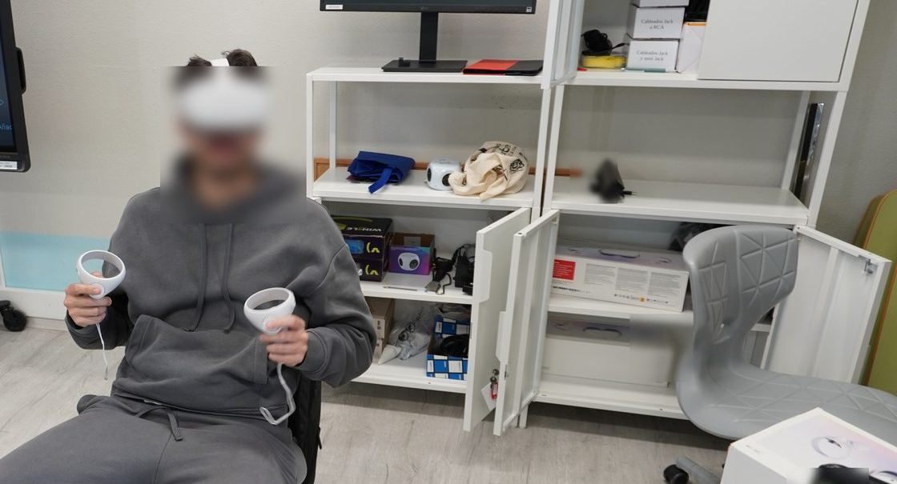

{ .ateca-hero__img .off-glb }

AR / VR (gafas) · Aula ATECA

<h1>Realidad virtual y aumentada</h1>

Qué son, en qué se diferencian y qué podemos hacer con ellas en clase, en cualquier familia profesional.

<a class="video-boton" href="https://www.youtube.com/watch?v=PLpDCK3Zy7Q" target="_blank" rel="noopener" title="Diferencia entre realidad virtual y aumentada (LearnFree en Español)">Vídeo · 2 minDiferencia entre realidad virtual y aumentadaLearnFree en Español</a>
<a class="video-boton" href="https://www.youtube.com/watch?v=5OeT2ehSe30" target="_blank" rel="noopener" title="VR y AR: tecnologías inmersivas en el aula (eduKmos)">Vídeo · 7 minVR y AR: tecnologías inmersivas en el aulaeduKmos</a>
<a class="video-boton" href="https://www.youtube.com/watch?v=kpZP57SzJ38" target="_blank" rel="noopener" title="Realidad aumentada en un instituto real (K-tuin Educación)">Vídeo · 3 minRealidad aumentada en un instituto realK-tuin Educación</a>

La **realidad virtual (VR)** y la **realidad aumentada (AR)** son dos formas de mezclar lo digital con lo que vemos, pero funcionan al revés: la VR nos saca del aula y nos mete en otro lugar; la AR deja el aula donde está y le añade información encima. En el Aula ATECA tenemos equipo para las dos.

## ¿Qué es la realidad virtual? { .seccion }

Con unas gafas de VR la persona deja de ver el aula y pasa a estar **dentro de un entorno generado por ordenador**: un taller, un aerogenerador a 80 m de altura, un quirófano o una planta industrial. Las gafas siguen el movimiento de la cabeza y de las manos (seis grados de libertad), así que se puede caminar, girarse, coger objetos y usar herramientas como en la realidad.

**Qué se puede hacer con ella en clase:**

- **Practicar procedimientos peligrosos o caros** sin riesgo y sin gastar material: maniobras en altura, uso de extintores, maquinaria de carpintería, montajes eléctricos.
- **Visitar lugares a los que no se puede ir**: empresas del sector, destinos turísticos, museos, el interior del cuerpo humano.
- **Repetir tantas veces como haga falta** un mismo ejercicio, con el simulador corrigiendo cada intento.
- **Entrenar habilidades blandas**: entrevistas de trabajo, atención al cliente o gestión de conflictos con personajes virtuales.

En el aula usamos las **[Meta Quest 2](meta-quest-2.md)**, gafas autónomas que no necesitan ordenador. Para simuladores más exigentes, como [SimulWind](simulwind.md), se conectan a un PC.

## ¿Qué es la realidad aumentada? { .seccion }

La AR **superpone contenido digital sobre el mundo real** a través de la cámara de una tablet o un móvil (o del *passthrough* de unas gafas). El contenido se "ancla" a algo que la cámara reconoce:

| Tipo de anclaje | Qué reconoce la cámara | Ejemplo en el aula |
|---|---|---|
| **Imagen o marcador** | Una foto, un cartel, la página de un libro | Un póster que, al enfocarlo, muestra el motor en 3D |
| **Superficie** | El suelo o una mesa | Colocar una máquina a tamaño real sobre la mesa del taller |
| **Espacio** | Un entorno escaneado previamente | Instrucciones de mantenimiento flotando junto a cada equipo de una sala |
| **Geolocalización** | La posición GPS | Una ruta turística con contenido en cada parada |

**Qué se puede hacer con ella en clase:**

- **Ver en 3D lo que el libro muestra en 2D**: órganos, piezas mecánicas, moléculas, edificios.
- **Medir y orientarse** con la cámara: distancias, ángulos, áreas.
- **Crear materiales propios**: carteles, fichas o maquetas que "cobran vida" al enfocarlos, diseñados por el propio alumnado con [Onirix Studio](onirix.md).

Para AR usamos las **tablets Samsung Galaxy Tab A 10.1** del aula y los móviles del alumnado.

## Qué podemos usar en clase { .seccion }

Las 6 gafas del aula comparten **una única cuenta Meta del centro** (el porqué está explicado en el [manual de las Quest 2](meta-quest-2.md)). Eso condiciona qué contenidos funcionan en todas las gafas a la vez:

| Tipo de contenido | Origen | ¿Las 6 gafas a la vez? |
|---|---|---|
| **APK** | itch.io, GitHub, web del desarrollador, SideQuest | ✅ Normalmente sí |
| **WebXR** | Navegador de las gafas (Meta Quest Browser) | ✅ Sí, sin instalar nada |
| **Vídeos 360°** | Copiados a las gafas con ADB | ✅ Sí |
| **Apps de la tienda de Meta** | Meta Horizon Store | ❌ Solo en una gafa a la vez |
| **Experiencias WebAR** | Navegador de la tablet o el móvil (Onirix) | ✅ Sí, con un enlace o un QR |

!!! warning "Límite de la cuenta única"
    Una misma cuenta **no puede abrir la misma app de la tienda de Meta en varias gafas a la vez** (pasa también con muchas apps gratuitas). Las **APK** instaladas a mano y las **experiencias web** normalmente no tienen esa comprobación. Si una app imprescindible de la tienda se bloquea, la solución es crear cuentas separadas solo para esa actividad.

### Apps de AR para las tablets

**Medición y orientación** (Energía y Agua, Edificación, Instalaciones)

- [AR Ruler](https://play.google.com/store/apps/details?id=com.grymala.aruler){target="_blank"} – distancias, áreas y volúmenes.
- [Transportador de ángulos AR](https://www3.gobiernodecanarias.org/medusa/ecoescuela/educatablet/recurso/transportador-virtual){target="_blank"} – medición de ángulos.
- [Brújula AR](https://www3.gobiernodecanarias.org/medusa/ecoescuela/educatablet/recurso/brujula-con-realidad-aumentada){target="_blank"} – orientación y navegación.

**Anatomía** (Sanidad)

- [Anatomy 4D](https://www3.gobiernodecanarias.org/medusa/ecoescuela/recursosdigitales/2015/01/24/anatomy-4d/){target="_blank"} – cuerpo humano en 4D.
- [AR Human Organs](https://play.google.com/store/apps/details?id=com.onebyoneapps.arhumanorgans){target="_blank"} – órganos humanos en 3D.
- [Essential Skeleton 3D](https://www3.gobiernodecanarias.org/medusa/ecoescuela/recursosdigitales/2014/11/25/essential-skeleton-4/){target="_blank"} – esqueleto interactivo.
- [The Brain in 3D](https://www3.gobiernodecanarias.org/medusa/ecoescuela/recursosdigitales/2015/01/24/the-brain-in-3d/){target="_blank"} – cerebro humano en 3D.
- [Anatomyou](https://www3.gobiernodecanarias.org/medusa/ecoescuela/recursosdigitales/2020/05/08/anatomyou/){target="_blank"} – endoscopio virtual.

!!! tip "Antes de la clase con tablets"
    Instala las apps **el día anterior** (descargan modelos 3D pesados), carga las tablets (la cámara y la GPU gastan mucha batería) y prepara una superficie plana y bien iluminada. Al abrir la app, explica al alumnado que **mueva despacio la tablet** unos segundos para que reconozca el entorno.

## Ideas por familia profesional { .seccion }

- **Seguridad y Medio Ambiente**: simulacros de incendio o evacuación imposibles de reproducir en el centro (inspirado en proyectos como *INNOFIRE-VR*).
- **Energía y Agua**: mantenimiento de aerogeneradores con [SimulWind](simulwind.md) y visitas virtuales a instalaciones.
- **Sanidad**: anatomía en 3D con las tablets y primeros auxilios en VR.
- **Hostelería y Turismo**: vídeos 360° como "excursión virtual" antes de una FCT y rutas turísticas en AR creadas por el alumnado.
- **Administración y Gestión**: entrevistas de trabajo y atención al cliente simuladas.
- **Informática y Comunicaciones**: crear experiencias WebAR con Onirix y escenas WebXR propias.

Tienes un catálogo completo en [Apps VR gratuitas por familia profesional](apps-vr-gratuitas.md).

## Para saber más { .seccion }

!!! info "Realidad virtual (VR)"
    - [Ayuda oficial de Meta Quest](https://www.meta.com/help/quest/){target="_blank"}
    - [Meta Horizon Store: apps y experiencias](https://www.meta.com/experiences/){target="_blank"}
    - [SideQuest: apps fuera de la tienda](https://sidequestvr.com/){target="_blank"}
    - [VRFP: simuladores por familia profesional](https://vrfp.es/familias-profesionales/todas-familias-profesionales/){target="_blank"}
    - [Simuladores VR para FP (Aulas ATECA)](https://aulasateca.com/simuladores-de-realidad-virtual-para-fp/){target="_blank"}
    - [WebXR: realidad virtual desde el navegador](https://immersiveweb.dev/){target="_blank"}

!!! tip "Realidad aumentada (AR)"
    - [Onirix Studio: crear experiencias WebAR](https://www.onirix.com/){target="_blank"}
    - [Documentación de Onirix](https://docs.onirix.com/){target="_blank"}
    - [Google ARCore: dispositivos compatibles](https://developers.google.com/ar/devices){target="_blank"}
    - [Sketchfab: modelos 3D para AR](https://sketchfab.com/){target="_blank"}
    - [WebAR en Wikipedia](https://en.wikipedia.org/wiki/WebAR){target="_blank"}

