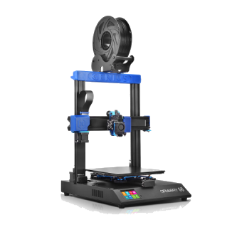

{ .ateca-hero__img .off-glb }

Impresora 3D · Aula ATECA

<h1>Artillery Genius Pro</h1>

La impresora FDM de batalla del aula: rápida de poner en marcha, nivelación automática y 220 × 220 × 250 mm.

<a class="video-boton" href="https://www.youtube.com/watch?v=h9ESMj-5Hnk" target="_blank" rel="noopener" title="Empezar con la Artillery Genius Pro (npirtube)">Vídeo · 21 minEmpezar con la Artillery Genius Pronpirtube</a>
<a class="video-boton" href="https://www.youtube.com/watch?v=PhYiOUoHdNc" target="_blank" rel="noopener" title="Calibrar la Artillery Genius Pro (Esdichi)">Vídeo · 6 minCalibrar la Artillery Genius ProEsdichi</a>
<a class="video-boton" href="https://www.youtube.com/watch?v=Wz1bV_D67X4" target="_blank" rel="noopener" title="Ultimaker Cura paso a paso (D1nuz)">Vídeo · 18 minUltimaker Cura paso a pasoD1nuz</a>

- **Tecnología:** FDM (filamento fundido), una boquilla.
- **Volumen de impresión:** 220 × 220 × 250 mm.
- **Filamento:** **1,75 mm** (PLA, PETG; TPU flexible con velocidad baja).
- **Extrusor:** *direct drive* tipo Titan con *hotend* Volcano.
- **Cama:** calefactada, con **nivelación automática** por sensor.
- **Extras:** pantalla táctil a color, sensor de fin de filamento y recuperación tras corte de luz.
- **Archivos:** `.gcode` en tarjeta **microSD**.

Es la impresora **de batalla** del aula: abierta, rápida de poner en marcha y con un volumen de impresión generoso. Úsala para prototipos, piezas de prueba, maquetas y cualquier trabajo en PLA donde no se necesite una precisión milimétrica. Para piezas que deban encajar con tolerancias ajustadas, usa la [Ultimaker S3](ultimaker-s3.md).

## Antes de empezar { .seccion }

- [ ] La cama está **limpia** (sin restos de la impresión anterior ni grasa de dedos). Si hace falta, pasa un paño con alcohol isopropílico.
- [ ] Hay **filamento de 1,75 mm** cargado y queda suficiente en la bobina para la pieza (Cura te dice los metros/gramos necesarios).
- [ ] La impresora está sobre una mesa estable y nadie la va a mover durante la impresión.
- [ ] Tienes el modelo en `.stl`, `.obj` o `.3mf` (diseñado por ti o descargado de un [repositorio de diseños](repositorios-disenos-3d.md)).

## 1. Preparar en Cura { .seccion }

1. Abre **Ultimaker Cura** y añade la impresora si es la primera vez: *Añadir impresora → Agregar una impresora no conectada en red → Artillery → **Artillery Genius Pro***. En versiones antiguas de Cura que no la incluyen, elige **Artillery Genius** y llámala "Genius Pro".
2. Arrastra el modelo a la ventana. Colócalo apoyado sobre su cara más ancha y plana: cuanta más superficie toque la cama, menos soportes y más adherencia.
3. Elige el perfil:

    | Ajuste | Valor recomendado (PLA) |
    |---|---|
    | Altura de capa | 0,2 mm (0,12 mm si quieres más detalle) |
    | Relleno | 15–20 % para piezas de exposición; 40 % o más para piezas funcionales |
    | Soportes | Solo si hay voladizos de más de 45° |
    | Adherencia | *Falda* (skirt) por defecto; *borde* (brim) en piezas pequeñas o altas |
    | Temperatura boquilla / cama | 200 °C / 60 °C |

4. Pulsa **Segmentación** y revisa el tiempo y el material estimados. Usa la **vista previa por capas** para comprobar que no hay zonas "flotando" en el aire.
5. Guarda el `.gcode` en la **tarjeta microSD** de la impresora. Usa un nombre corto y sin tildes (por ejemplo `llavero_grupo3.gcode`): la pantalla corta los nombres largos.

## 2. Puesta en marcha { .seccion }

1. Enciende la impresora con el interruptor de la base y espera a que cargue la pantalla táctil.
2. **Nivelación automática.** Desde el menú de nivelación de la pantalla, lanza la **auto-nivelación**: el sensor del cabezal palpa varios puntos de la cama y guarda el mapa. No es necesario repetirla en cada impresión, pero sí si alguien ha movido la impresora o la primera capa sale irregular.
3. **Ajuste de Z-offset** (solo si la primera capa no pega o sale aplastada): con la boquilla en el centro de la cama, sube o baja el Z-offset en pasos de 0,05 mm hasta que una hoja de papel pase rozando entre la boquilla y la cama.
4. **Cargar filamento:**
    1. Precalienta la boquilla a la temperatura del material (menú *Precalentar → PLA*).
    2. Corta la punta del filamento en diagonal, aprieta la palanca del extrusor e introduce el filamento hasta notar que llega a la boquilla.
    3. Extruye unos centímetros desde el menú de movimiento (eje E) hasta que salga material limpio y del color correcto.
5. **Imprimir:** inserta la microSD, entra en *Imprimir*, elige el archivo y confirma.

!!! warning "Vigila las primeras capas"
    Quédate junto a la impresora durante las **3–5 primeras capas**. Si el plástico no se pega, se arrastra o forma "bolitas", detén la impresión, limpia la cama y revisa el Z-offset. Una mala primera capa no se arregla sola: solo empeora.

## 3. Al terminar { .seccion }

1. Espera a que la cama baje de unos **35 °C**: muchas piezas se sueltan solas al enfriarse.
2. Retira la pieza con la espátula, siempre empujando **en paralelo a la cama** y alejando la otra mano de la trayectoria.
3. Quita los restos de falda o borde y deja la cama limpia.
4. Si eres el último grupo del día, apaga la impresora **cuando la boquilla haya bajado de 50 °C** (el ventilador del *hotend* debe seguir funcionando mientras se enfría).

## Problemas habituales { .seccion }

| Síntoma | Causa probable | Solución |
|---|---|---|
| La pieza se despega de la cama | Cama sucia o Z-offset demasiado alto | Limpia con alcohol isopropílico y baja el Z-offset 0,05 mm; añade borde (brim) |
| Primera capa transparente o rayada | Boquilla demasiado cerca de la cama | Sube el Z-offset 0,05 mm |
| No sale filamento | Atasco o filamento mal cargado | Descarga, corta la punta y vuelve a cargar con la boquilla caliente |
| "Hilos" entre partes de la pieza | Temperatura alta o retracción insuficiente | Baja 5–10 °C y revisa la retracción en Cura |
| Chisporroteo y superficie rugosa | Filamento con humedad | Cambia de bobina; guarda el filamento en bolsa hermética con gel de sílice |
| La impresora se para a mitad | Fin de filamento | Carga una bobina nueva y reanuda desde la pantalla |

## Mantenimiento { .seccion }

- **Cada sesión:** limpiar la cama y retirar restos de plástico de la boquilla (con la boquilla caliente y unas pinzas, nunca con los dedos).
- **Cada mes:** comprobar que las correas de los ejes X e Y están tensas y que las ruedas de los perfiles no tienen holgura.
- **Cada trimestre:** limpiar el engranaje del extrusor con un cepillo y revisar el desgaste de la boquilla.

## Recursos { .seccion }

- 🧩 [Ultimaker Cura](https://ultimaker.com/es/software/ultimaker-cura){target="_blank"} — laminador gratuito compatible con la Genius Pro.
- 📖 [Manual de usuario de la Artillery Genius Pro (ManualsLib)](https://www.manualslib.de/manual/880825/Artillery-Genius-Pro.html){target="_blank"} — incluye montaje, nivelación y especificaciones.
- 🛠️ [Flujo completo de diseño y fabricación 3D](diseno-fabricacion-3d.md) — del diseño a la pieza terminada.
