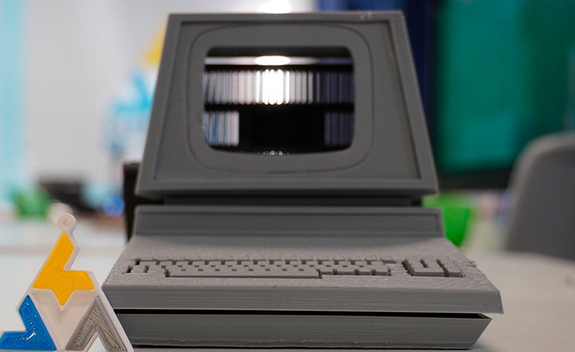
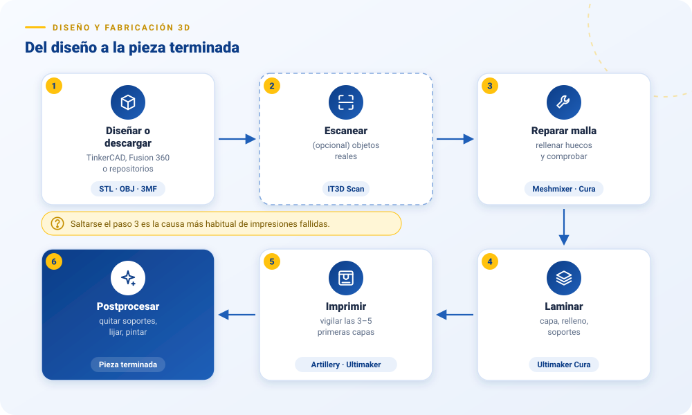

{ .ateca-hero__img .off-glb }

Impresora 3D · Aula ATECA

<h1>Diseño y fabricación 3D</h1>

Del diseño en pantalla a la pieza en la mano: modelado, escaneo, laminado e impresión con los equipos del aula.

<a class="video-boton" href="https://www.youtube.com/watch?v=S3O2ehqDuJM" target="_blank" rel="noopener" title="Cómo funcionan las impresoras 3D (Xataka)">Vídeo · 7 minCómo funcionan las impresoras 3DXataka</a>
<a class="video-boton" href="https://www.youtube.com/watch?v=csvBRWfgf1I" target="_blank" rel="noopener" title="Diseña tu primera pieza con TinkerCAD (El Rincón de Primaria)">Vídeo · 9 minDiseña tu primera pieza con TinkerCADEl Rincón de Primaria</a>
<a class="video-boton" href="https://www.youtube.com/watch?v=LIZkCKQfU6s" target="_blank" rel="noopener" title="Ultimaker Cura para principiantes (Planeta Voxel)">Vídeo · 19 minUltimaker Cura para principiantesPlaneta Voxel</a>

> Equipamiento del Aula ATECA para modelado, escaneo e impresión 3D: dos impresoras ([Artillery Genius Pro](artillery-genius-pro.md) y [Ultimaker S3](ultimaker-s3.md)) y un escáner 3D (IT3D Scan). Para descargar diseños ya hechos y listos para imprimir, consulta el documento [Repositorios de diseños 3D gratuitos](repositorios-disenos-3d.md).

## Flujo de trabajo general { .seccion }

{ .diagrama .off-glb }

Antes de entrar en cada máquina, conviene tener claro el recorrido completo: **diseñar o descargar → (opcional) escanear → reparar la malla → laminar → imprimir → postprocesar**. Saltarse el paso de reparar la malla es la causa más habitual de que una impresión falle a mitad de proceso.

## 1. Las dos impresoras { .seccion }

| | [Artillery Genius Pro](artillery-genius-pro.md) | [Ultimaker S3](ultimaker-s3.md) |
|---|---|---|
| **Para qué usarla** | Prototipos, pruebas y piezas de PLA del día a día | Piezas técnicas, encajes precisos e impresiones largas |
| **Volumen** | 220 × 220 × 250 mm | 230 × 190 × 200 mm |
| **Filamento** | 1,75 mm | 2,85 mm |
| **Extrusores** | 1 | 2 (permite soporte soluble de PVA) |
| **Archivo** | `.gcode` en microSD | `.ufp` por USB o red |

!!! warning "Los filamentos no son intercambiables"
    Cada impresora usa un diámetro distinto: **1,75 mm** la Artillery y **2,85 mm** la Ultimaker. Comprueba la etiqueta de la bobina antes de cargarla.

Cada impresora tiene su propia guía paso a paso (preparación en Cura, puesta en marcha, retirada de la pieza, problemas habituales y mantenimiento):

- 🖨️ [Guía de uso de la Artillery Genius Pro](artillery-genius-pro.md)
- 🖨️ [Guía de uso de la Ultimaker S3](ultimaker-s3.md)

### Temperaturas por material

| Material | Boquilla | Cama | Notas |
|---|---|---|---|
| PLA | 190-210 °C | 50-60 °C | El más fácil para empezar, poco olor |
| PETG | 220-240 °C | 70-80 °C | Más resistente, algo más difícil de imprimir |
| ABS | 230-250 °C | 90-100 °C | Mejor en la Ultimaker, con la puerta cerrada y buena ventilación |

En la Ultimaker S3 no hace falta ajustar temperaturas a mano: los perfiles de material de Cura ya las traen.

## 2. Escáner IT3D Scan { .seccion }

Escáner que captura objetos y entornos en 3D con alta precisión, generando modelos que pueden editarse, repararse e imprimirse.

### 2.1 Flujo básico

1. Coloca el objeto sobre una superficie neutra, con buena iluminación difusa (evita reflejos y superficies muy brillantes o transparentes: pulverizar spray mate ayuda en objetos metálicos o de vidrio).
2. Escanea rotando el objeto o el escáner según el modelo, cubriendo todos los ángulos; ve comprobando en pantalla que no quedan "agujeros" en la nube de puntos.
3. Exporta la malla (`.stl`/`.obj`) y **repárala** si es necesario (rellenar huecos, suavizar) con software como Meshmixer o el propio software del escáner.
4. Importa el modelo reparado en el *slicer* (Cura) para imprimirlo.

### 2.2 Buenas prácticas

- Los objetos pequeños y con detalle fino dan mejor resultado que piezas muy grandes.
- Evita escanear con luz solar directa cambiante (las sombras se mueven durante el escaneo): mejor luz artificial estable.

## 📚 Software 3D { .seccion }

- [TinkerCAD](https://www.tinkercad.com/3d-design){target="_blank"} – Modelado online para iniciación, ideal en 1º de ciclos.
- [Fusion 360](https://www.autodesk.es/products/fusion-360){target="_blank"} – CAD profesional con simulación (licencia educativa gratuita).
- [SketchUp](http://www.sketchup.com/es/products/sketchup-for-web){target="_blank"} – Modelado intuitivo orientado a arquitectura/diseño.
- [FreeCAD](https://www.freecadweb.org){target="_blank"} – CAD paramétrico libre y gratuito.
- [Ultimaker Cura](https://ultimaker.com/es/software/ultimaker-cura){target="_blank"} – Laminador (*slicer*) gratuito, válido para ambas impresoras del aula.

## 📚 Recursos { .seccion }

- 🎥 [Vídeo de presentación del escáner IT3D Scan](https://youtu.be/xN-ANLl4h64){target="_blank"}
- 🎓 [Curso IT3D Scan ONE](https://formacion.it3d.com/curso/Curso-IT3D-Scan-ONE){target="_blank"}
- 📦 [Repositorios de diseños 3D gratuitos](repositorios-disenos-3d.md) — documento específico de este proyecto.
- 🌐 Web del Aula ATECA (fuente de este manual): [Tecnologías | Aula AtecA](https://www3.gobiernodecanarias.org/medusa/proyecto/35014664-0006/aplicaciones/){target="_blank"}

> 📷 **Pendiente:** añadir fotos reales de las dos impresoras y del escáner del aula, y ejemplos de piezas impresas por el alumnado.
