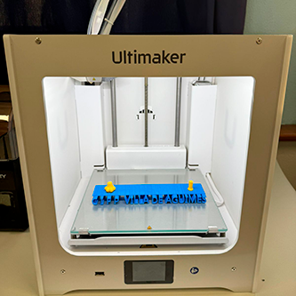

{ .ateca-hero__img .off-glb }

Impresora 3D · Aula ATECA

<h1>Ultimaker S3</h1>

La impresora de precisión del aula: doble extrusión, perfiles de material listos en Cura y filamento de 2,85 mm.

<a class="video-boton" href="https://www.youtube.com/watch?v=-w_d3bJF2YI" target="_blank" rel="noopener" title="Imprimir una pieza en la Ultimaker (Tecnología de Fabricación (UR))">Vídeo · 9 minImprimir una pieza en la UltimakerTecnología de Fabricación (UR)</a>
<a class="video-boton" href="https://www.youtube.com/watch?v=G4G0sU5VMlI" target="_blank" rel="noopener" title="Gestionar y editar materiales (UltiMaker)">Vídeo · 3 min · inglésGestionar y editar materialesUltiMaker</a>
<a class="video-boton" href="https://www.youtube.com/watch?v=LdWmIKNILxA" target="_blank" rel="noopener" title="Cargar material y print cores en la S3 (Pebblereka 3D)">Vídeo · 2 min · inglésCargar material y print cores en la S3Pebblereka 3D</a>

- **Tecnología:** FFF con **doble extrusión** (dos *print cores* intercambiables).
- **Volumen de impresión:** 230 × 190 × 200 mm.
- **Filamento:** **2,85 mm** (no sirve el de 1,75 mm de la Artillery).
- **Cama:** vidrio calefactado con **nivelación activa** automática.
- **Pantalla:** táctil a color de 4,7".
- **Archivos:** `.ufp` (o `.gcode`) por **USB**, red o Ultimaker Digital Factory.

Es la impresora **de precisión** del aula: cerrada por delante, muy fiable y con perfiles de material ya ajustados en Cura. Úsala para piezas técnicas, piezas que deban encajar entre sí o impresiones largas que necesiten salir bien a la primera. Para pruebas rápidas y prototipos en PLA, usa la [Artillery Genius Pro](artillery-genius-pro.md).

!!! danger "Filamento de 2,85 mm"
    La Ultimaker S3 usa filamento de **2,85 mm**. Una bobina de 1,75 mm (la de la Artillery) **no funciona** y puede atascar el alimentador. Comprueba el diámetro en la etiqueta de la bobina antes de cargarla.

## Antes de empezar { .seccion }

- [ ] La placa de vidrio está **limpia** y bien sujeta por las pinzas delanteras y traseras.
- [ ] Hay material de **2,85 mm** cargado en el extrusor que vas a usar. Las bobinas Ultimaker con etiqueta NFC se reconocen solas; con otras marcas tendrás que indicar el material en la pantalla.
- [ ] Sabes qué *print core* hay montado en cada ranura (se ve en la pantalla, en *Material/Print core*): **AA** para materiales de construcción (PLA, Tough PLA, PETG, ABS…) y **BB** para soporte soluble (PVA).
- [ ] Tienes el modelo en `.stl`, `.obj` o `.3mf`.

## 1. Preparar en Cura { .seccion }

1. En **Ultimaker Cura**, añade la impresora: *Añadir impresora → **UltiMaker S3***. Si está conectada a la red del aula, aparecerá en *Impresoras en red* y podrás enviarle los trabajos directamente.
2. En la barra superior, indica **qué material y qué print core** hay en cada extrusor (si la impresora está en red, Cura lo lee solo).
3. Arrastra el modelo y elige un **perfil predefinido** (por ejemplo *Normal – 0,15 mm*). Los perfiles de Ultimaker ya traen temperaturas, velocidades y retracción ajustadas para cada material: en el aula, cámbialos solo si sabes por qué.
4. Si la pieza tiene voladizos complejos y hay PVA en el extrusor 2, activa los **soportes con el extrusor 2**: el soporte se disuelve después en agua.
5. Pulsa **Segmentación** y revisa la vista previa por capas.
6. Envía el trabajo:
    - **Por red:** botón *Imprimir a través de la red*.
    - **Por USB:** *Guardar en disco extraíble* (genera un `.ufp`, que incluye una miniatura de la pieza).

## 2. Imprimir { .seccion }

1. Enciende la impresora con el interruptor trasero y espera a que arranque.
2. Si el trabajo va por **USB**, conecta la memoria en el puerto frontal, pulsa **Imprimir** y elige el archivo. Si va **por red**, aparecerá en la cola: confírmalo en la pantalla o desde Cura.
3. La impresora calienta, hace la **nivelación activa** de la placa (el cabezal palpa la cama) y empieza a imprimir. No hace falta nivelar a mano.
4. Cierra la **puerta frontal** durante la impresión: mantiene estable la temperatura y evita deformaciones (*warping*), sobre todo con ABS o Tough PLA.

!!! tip "Cambiar el material"
    Usa siempre el asistente de la pantalla: *Material/Print core → Extrusor 1 o 2 → **Cambiar***. La impresora calienta, descarga el filamento antiguo y te indica cuándo introducir el nuevo en el alimentador trasero hasta que lo "muerda". No tires del filamento a mano con la boquilla fría.

## 3. Al terminar { .seccion }

1. Espera a que la placa de vidrio se enfríe: la mayoría de piezas se despegan solas.
2. Si la pieza sigue pegada, abre las pinzas, saca la placa con cuidado y usa la espátula **en paralelo al vidrio**. No golpees ni fuerces la placa: es vidrio templado, pero se puede romper.
3. Si se usó **pegamento en barra**, lava la placa con agua templada, sécala bien y vuelve a colocarla con las pinzas.
4. Confirma en la pantalla que has retirado la pieza (*Confirmar retirada*) para que la impresora quede lista para el siguiente trabajo.
5. Si había soporte de **PVA**, sumerge la pieza en agua templada (cambia el agua cada pocas horas) hasta que el soporte desaparezca.

## Problemas habituales { .seccion }

| Síntoma | Causa probable | Solución |
|---|---|---|
| La impresora pide confirmar el material | Bobina sin etiqueta NFC | Selecciona en la pantalla el material y el diámetro correctos |
| "Material no compatible con el print core" | Combinación no permitida (por ejemplo PVA en AA) | Cambia el print core o el material desde *Material/Print core* |
| Las piezas de dos colores no coinciden | Offset XY sin calibrar tras cambiar un print core | *Mantenimiento → Print core → Calibración de offset XY* |
| La pieza se despega o se curva | Placa sucia o puerta abierta | Limpia la placa, aplica una capa fina de pegamento en barra y cierra la puerta |
| Aviso de falta de flujo | Fin de bobina o filamento enredado | Revisa la bobina trasera y carga material nuevo con el asistente |

## Mantenimiento { .seccion }

- **Cada sesión:** placa limpia y sin restos de pegamento; cabezal sin hilos de plástico.
- **Cada mes:** ejecutar desde la pantalla la **limpieza del print core** (*cold pull* guiado) si se ha impreso mucho o se ha cambiado de material a menudo.
- **Cada trimestre:** lubricar los ejes y husillos con la grasa incluida, siguiendo el asistente de *Mantenimiento* de la pantalla.
- Mantén el **firmware** actualizado (*Preferencias → Mantenimiento → Actualizar firmware*, con la impresora conectada a internet).

## Recursos { .seccion }

- 🧩 [Ultimaker Cura](https://ultimaker.com/es/software/ultimaker-cura){target="_blank"} — laminador oficial con perfiles para la S3.
- 📖 [Centro de soporte de UltiMaker](https://support.ultimaker.com/){target="_blank"} — manuales, vídeos de mantenimiento y guías de materiales.
- 🛠️ [Flujo completo de diseño y fabricación 3D](diseno-fabricacion-3d.md) — del diseño a la pieza terminada.
