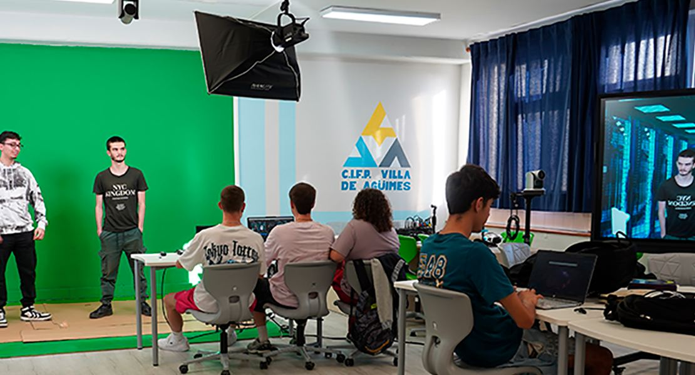
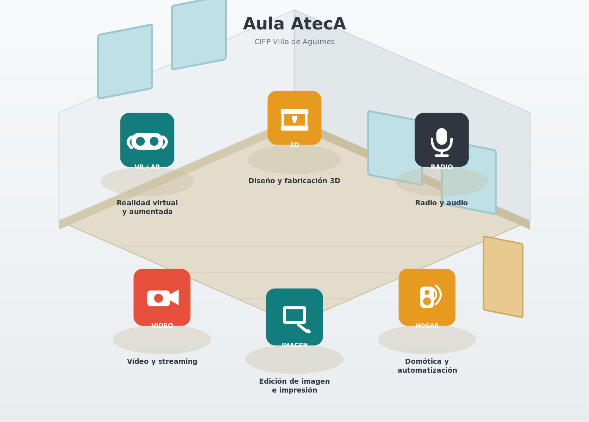

{ .ateca-hero__img .off-glb }

CIFP Villa de Agüimes · Aula ATECA

<h1>Aula de Tecnología Aplicada</h1>

Un espacio que se parece a un entorno de trabajo real: equipos de los sectores productivos, simuladores y tecnología al servicio de todos los módulos profesionales.

El **Aula ATECA** es el lugar del centro donde alumnado y profesorado de **cualquier familia profesional** pueden diseñar, fabricar, grabar, experimentar y presentar su trabajo con el mismo tipo de equipos que se usan en las empresas. No es un aula de informática ni un plató: es un espacio flexible que se reorganiza según el proyecto de cada grupo.

Nació dentro del **Plan de Modernización de la Formación Profesional**, en la actuación de *conversión de aulas en espacios de tecnología aplicada*, financiada por el Ministerio de Educación y la Unión Europea (**NextGenerationEU**). Puedes consultar el programa en la web de la [Consejería de Educación del Gobierno de Canarias](https://www.gobiernodecanarias.org/educacion/web/programas_cofinanciados/nextgenerationeu/plan-fp-crecimiento-economico-social-empleabilidad/conversion_aulas_espacios_tecnologia_aplicada/){target="_blank"}.

Esta web reúne los **manuales de uso** de cada equipo del aula: cómo se enciende, cómo se configura, qué hacer cuando algo falla y cómo dejarlo listo para el siguiente grupo. Elige el equipo en el menú de la izquierda.

## Cuatro espacios { .seccion }

El modelo ATECA organiza el aula en cuatro espacios según lo que se hace en cada uno:

| Espacio | Para qué sirve | Equipamiento |
|---|---|---|
| **Presenta / Interactúa** | Debates, videoconferencias y trabajo colaborativo | Pantalla interactiva, megafonía, videoconferencia |
| **Crea / Desarrolla** | Diseñar, fabricar y producir | Impresoras y escáner 3D, equipos informáticos, audiovisuales |
| **Explora** | Acercarse virtualmente a entornos profesionales | Gafas de realidad virtual y aumentada |
| **Investiga** | Metodologías activas (Design Thinking, retos) | Sistema de presentación multimedia |

## Zonas de nuestra aula { .seccion }

{ .diagrama width="760" }

En la práctica, esos cuatro espacios se reparten en seis zonas de trabajo: **realidad virtual y aumentada**, **diseño y fabricación 3D**, **radio y audio**, **vídeo y streaming** (con plató de croma), **edición de imagen e impresión** y **domótica**. Cada una tiene su propio apartado en el menú.

!!! tip "¿Quieres usar el aula con tu grupo?"
    El aula se reserva por franjas horarias desde el [sistema de reservas del centro](https://www3.gobiernodecanarias.org/educacion/cau_ce/reservas/35014664/edit_room.php?room=58){target="_blank"}. Antes de la sesión, revisa el manual del equipo que vayas a usar: casi todos los problemas habituales están resueltos ahí.
