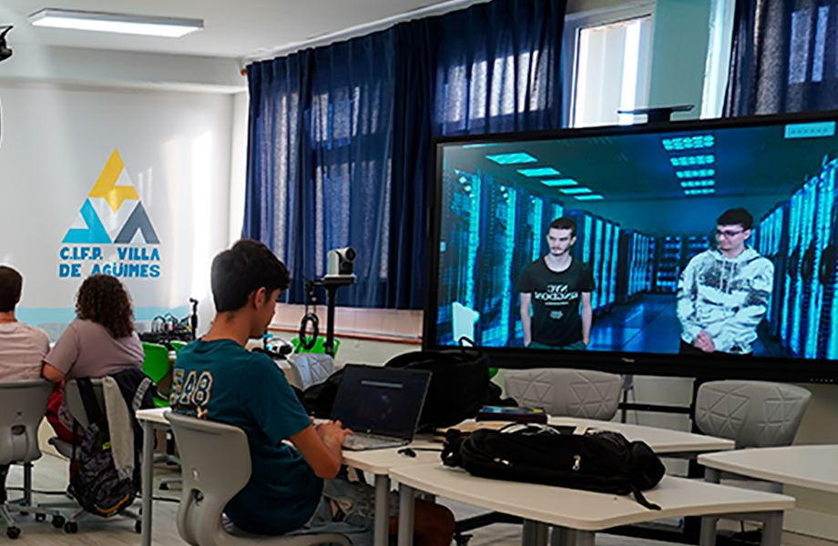

{ .ateca-hero__img .off-glb }

Pantalla interactiva · Aula ATECA

<h1>Newline Lyra TT-8621Q</h1>

Pizarra digital de 86" en 4K: anotación sobre cualquier contenido, proyección inalámbrica y apps para el aula.

<a class="video-boton" href="https://www.youtube.com/watch?v=wCeUUvvq7Bg" target="_blank" rel="noopener" title="Primeros pasos con la pantalla Newline (IES · Jefatura Vespertino)">Vídeo · 3 minPrimeros pasos con la pantalla NewlineIES · Jefatura Vespertino</a>
<a class="video-boton" href="https://www.youtube.com/watch?v=ZNd8-nDuBgI" target="_blank" rel="noopener" title="Introducción al monitor Newline Lyra (CP Juan de Lanuza)">Vídeo · 8 minIntroducción al monitor Newline LyraCP Juan de Lanuza</a>
<a class="video-boton" href="https://www.youtube.com/watch?v=fm5pv16KZCU" target="_blank" rel="noopener" title="Compartir pantalla con Newline Cast (cddaragon)">Vídeo · 4 minCompartir pantalla con Newline Castcddaragon</a>

!!! info "OBJETIVOS"
    Este manual explica cómo **encender, conectar y usar** la pantalla interactiva **Newline Lyra TT-8621Q** del aula ATECA: pizarra digital, anotación sobre cualquier contenido, proyección inalámbrica desde portátiles y móviles, y las herramientas incluidas para el aula.

!!! info "RECURSOS"
    - Pantalla **Newline TT-8621Q** con su mando a distancia y los lápices pasivos.
    - Cable **USB-C** (un solo cable para imagen, táctil y carga del portátil) o cable **HDMI + USB táctil**.
    - Memoria USB formateada en **FAT32** para guardar la pizarra.
    - Wifi del centro para la proyección inalámbrica.

## **La pantalla** { .seccion }

### 1. Características

| Característica | TT-8621Q |
|---|---|
| Tamaño y resolución | 86", 4K UHD (3840 × 2160) |
| Tecnología táctil | Infrarrojos (IR), **20 puntos** a la vez, con dedo o lápiz pasivo |
| Cristal | Antirreflejos, antihuellas y **antimicrobiano** |
| Sistema integrado | **Android 11**, 4 GB de RAM, 32 GB + tarjeta SD de 32 GB |
| Conectividad | Wifi 6 + Bluetooth 5.2, 2 × RJ-45 (entrada y salida) |
| Entradas de vídeo | 3 × HDMI 2.0, 1 × DisplayPort 1.2, 2 × USB-C |
| Salidas | HDMI out, línea de audio, S/PDIF |
| USB-C | Frontal con **carga de 65 W** (un solo cable para el portátil) |
| Ranura OPS | Para un PC Windows integrado (opcional) |
| Audio | 2 altavoces frontales de 20 W, entrada de micrófono |
| Control | RS-232 y mando a distancia |
| Cámara | Módulo 4K opcional |

!!! tip "Distancia de visión"
    El fabricante recomienda unos **3,4 m** de distancia para esta pantalla de 86".

### 2. Encender y apagar

1. Comprueba que el **interruptor trasero** (junto al cable de corriente) está en **I**.
2. Pulsa el **botón de encendido** del panel frontal o del mando. LED **blanco** = encendida.
3. **Pulsación corta**: modo suspensión (LED rojo y blanco alternos).
4. **Pulsación larga (más de 2 s)**: aparece el aviso *Turn off*. Confirma para apagar (LED **rojo**).

!!! warning "Apagado correcto"
    Apaga siempre desde el botón antes de cortar la corriente. Un corte brusco puede dañar el panel. No la enciendas y apagues muchas veces seguidas.

### 3. Botones y mando

| Control | Acción |
|---|---|
| Encendido | Corta: encender / suspender · Larga: apagar |
| Volumen | Corta: ajustar · **Larga 5 s: activar o desactivar el táctil** |
| Brillo | Ajustar el brillo |
| Inicio | Ir a la pantalla de inicio |
| Ajustes rápidos | Corta: abrir el menú · Larga 5 s: bloquear el botón de encendido |
| Mando: **congelar** | Congela la imagen (pulsar otra vez para salir) |
| Mando: **fuente** | Cambiar de entrada (HDMI, USB-C, DP, OPS) |
| Mando: **captura** | Captura de pantalla |

!!! tip "Menú de ajustes rápidos"
    Desliza **dos dedos hacia arriba** desde el borde inferior: brillo, volumen, congelar, silencio, modo **solo sonido**, **pantalla dividida**, bloquear pantalla y herramientas de clase.

## **Uso en clase** { .seccion }

### 4. Inicio y barras laterales

En la pantalla de inicio verás reloj, fecha, la **vista previa de la fuente** conectada y los iconos principales: **OPS**, **Navegador**, **Pizarra**, **Archivos**, **Apps** y **Compartir pantalla**.

A ambos lados hay una **barra de herramientas** con: fuente OPS, Inicio, **Anotación**, **Pizarra**, Apps, **Fuentes**, cambio de aplicación y Volver. Puedes subirla, bajarla o minimizarla.

### 5. Conectar un portátil

| Conexión | Qué hacer |
|---|---|
| **USB-C** (recomendado) | Un solo cable: imagen, sonido, táctil y **carga del portátil (65 W)** en el puerto frontal |
| **HDMI + USB táctil** | Conecta el HDMI para la imagen y el cable **USB táctil** (USB-B) para controlar el portátil desde la pantalla |
| **DisplayPort** | Igual que HDMI, máximo 1,8 m de cable |

1. Conecta el cable.
2. Pulsa **Fuentes** en la barra lateral y elige la entrada (los iconos en blanco tienen señal).
3. Si el táctil no coincide con el dedo en Windows: *Panel de control → Configuración de Tablet PC → Calibrar*.

!!! note "Cables"
    Usa cables certificados: máximo **3 m en HDMI** y **1,8 m en DisplayPort**.

### 6. Pizarra digital

Pulsa **Pizarra** en el inicio o en la barra lateral.

| Herramienta | Uso |
|---|---|
| Lápiz y rotulador | Escribir. Mantén pulsado 2 s para cambiar grosor y color |
| Subrayador | Resaltar sin tapar el texto |
| Formas | Círculo, elipse, cuadrado, triángulos, estrella, flecha, línea |
| Seleccionar | Mover, escalar, girar, copiar, bloquear o borrar objetos |
| Borrador | Parcial o por objeto. **La palma o el puño borran** |
| Mover lienzo | Desplazar la pizarra infinita |
| Páginas | Hasta **99 páginas**, con miniaturas para navegar |
| Más opciones | Insertar imágenes, texto, notas adhesivas, PDF, **buscar imágenes o webs**, reglas y cámara de documentos |

!!! tip "Reconocimiento inteligente"
    La pantalla distingue el **lápiz fino**, el **dedo** y la **palma**: escribe con el lápiz, mueve con el dedo y borra con la palma sin cambiar de herramienta. Se configura en *Ajustes de la pizarra → Reconocimiento de objetos*.

**Guardar y compartir la pizarra:**

- **Código QR**: el alumnado escanea el QR con el móvil y se lleva las páginas de la clase.
- **USB**: guarda las páginas en una memoria **FAT32**.
- **Correo**: envía las páginas con la app AquaMail.

### 7. Anotar sobre todo

Pulsa **Anotación** en la barra lateral: aparece una capa transparente para escribir sobre lo que se esté viendo (una web, un PDF, un vídeo o el portátil conectado). Al salir se guarda una **captura** en *Almacenamiento interno → Pictures → Screenshots*.

### 8. Compartir sin cables

| Herramienta | Qué hace |
|---|---|
| **Newline Cast** (*Compartir pantalla*) | Proyecta desde portátiles, tablets y móviles. Admite **AirPlay** y **Google Cast**; las instrucciones aparecen en la pantalla |
| **Newline Broadcast** | Hace lo contrario: **envía la pantalla a los dispositivos del alumnado** a través del navegador |

!!! note "Red"
    Los dispositivos deben estar en la **misma red** que la pantalla.

### 9. Apps incluidas

| App | Uso en el aula |
|---|---|
| **Office Suite** | Abrir Word, Excel, PowerPoint y PDF sin ordenador |
| **File Viewer** | Explorar la memoria interna, USB, red y nube |
| **Vote** | Votaciones y encuestas rápidas en clase |
| **Visualizer** | Usar una cámara de documentos |
| **Reloj** | Temporizador, cronómetro y alarmas para actividades |
| **Newline Classroom** | Herramientas de clase (desde ajustes rápidos) |
| **Newline Engage Cloud** | Pizarra colaborativa en la nube |
| **Chromium / Navegador** | Navegar por la web |
| **Newline App Store** | Instalar más apps educativas |

### 10. Ajustes útiles

| Ajuste | Dónde | Para qué |
|---|---|---|
| **Pantalla dividida** | Ajustes rápidos | Dos apps a la vez (pizarra + web) |
| **Congelar imagen** | Ajustes rápidos o mando | Preparar algo en el portátil sin que se vea |
| **Solo sonido** | Ajustes rápidos | Apaga la imagen y mantiene el audio |
| **Filtro de luz azul** | *Ajustes → Filtros de pantalla* | Menos fatiga visual |
| **Encendido y apagado programado** | *Ajustes → Energía* | Ahorro de energía fuera del horario |
| **Fuente al encender** | *Ajustes → Entrada y salida* | Arrancar directamente en el portátil o en Android |
| **Cuentas** | *Ajustes → Sistema* | Modo de un usuario o multiusuario, con perfiles de profesorado e invitado |
| **Bloqueos** | *Ajustes → Sistema → Seguridad* | Bloquear USB, instalación de apps, ajustes o botones |

!!! warning "Modo administrador"
    Los bloqueos y las cuentas se gestionan en el **modo administrador**. Su contraseña está en el manual del fabricante: **cámbiala** y guárdala fuera de esta web.

## **Ideas y problemas** { .seccion }

### 11. Ideas para el ATECA

- **Clase con pizarra infinita**: explicar, guardar las páginas y compartirlas por **QR** al terminar.
- **Corrección en directo**: proyectar un trabajo del alumnado con **Newline Cast** y anotar encima.
- **Votaciones** con la app **Vote** para comprobar la comprensión.
- **Producción audiovisual**: llevar la salida **HDMI out** al [ATEM Mini Pro](../video/atem-mini-pro-croma.md) o a [OBS](../video/obs.md) para grabar o emitir la clase.
- **Control por RS-232**: encender, cambiar de fuente o activar la pizarra desde un PC o un sistema domótico (útil para prácticas de sistemas y automatización).
- **Videoconferencia** con el módulo de cámara 4K opcional.

### 12. Problemas frecuentes

??? question "El táctil no funciona con el portátil"
    Comprueba el cable **USB táctil** (o usa USB-C), cambia de fuente y vuelve, o recalibra en Windows.

??? question "No se guarda la pizarra en el USB"
    Formatea la memoria en **FAT32**.

??? question "No hay sonido por HDMI"
    Sube el volumen en la pantalla y en el portátil, y comprueba que ninguno esté en silencio. Desconecta y vuelve a conectar el HDMI.

??? question "La pantalla se apaga sola"
    Revisa *Ajustes → Energía*: el ahorro de energía bloquea la pantalla y la apaga si no se usa en 2 minutos.

??? question "El táctil no responde en ninguna fuente"
    Puede haberse desactivado: mantén pulsado el botón de **volumen** 5 segundos.

## **Manuales y enlaces** { .seccion }

- [Manual extendido Lyra (serie Q) · PDF](https://cdn.shopify.com/s/files/1/0267/8839/7133/files/User_Manual_Extended_Lyra_GMAV.pdf){target="_blank"}
- [Ficha técnica de la serie Q · PDF](https://newline-interactive.com/wp-content/uploads/2023/06/Q-specsheet_APAC_20230509.pdf){target="_blank"}
- [Descargas de Newline Europa (manuales, Newline Cast, Broadcast)](https://newline-interactive.com/eu/downloads){target="_blank"}
