# 🟩 ATEM Mini Pro (croma) *Guía de configuración del plató de croma paso a paso* { .card }

[:material-file-pdf-box: Descargar manual en PDF](../assets/pdf/atem-mini-pro-croma.pdf){ .md-button .md-button--primary download="atem-mini-pro-croma.pdf" style="display:table;margin:0 auto;" }

<figure>
<iframe src="https://www.youtube-nocookie.com/embed/pCIjtsxb5SY" title="Cómo usar el ATEM Mini Pro (guía completa)" loading="lazy" allow="accelerometer; clipboard-write; encrypted-media; gyroscope; picture-in-picture" allowfullscreen></iframe>
<figcaption>Cómo usar el ATEM Mini Pro (guía completa)</figcaption>
</figure>
<figure>
<iframe src="https://www.youtube-nocookie.com/embed/UVcTbvX5AUc" title="Fondo verde con el ATEM Mini Pro" loading="lazy" allow="accelerometer; clipboard-write; encrypted-media; gyroscope; picture-in-picture" allowfullscreen></iframe>
<figcaption>Fondo verde con el ATEM Mini Pro</figcaption>
</figure>
<figure>
<iframe src="https://www.youtube-nocookie.com/embed/f6ViRCaBzlY" title="OBS con ATEM Mini Pro para directos (inglés)" loading="lazy" allow="accelerometer; clipboard-write; encrypted-media; gyroscope; picture-in-picture" allowfullscreen></iframe>
<figcaption>OBS con ATEM Mini Pro para directos (inglés)</figcaption>
</figure>

> Esta guía explica cómo poner en marcha el **plató de croma** del centro con el mezclador de vídeo **Blackmagic ATEM Mini Pro** y el programa **ATEM Software Control**. Al terminar, la persona situada delante del fondo verde aparecerá sobre la imagen de fondo que elijamos (un paisaje, un cartel, una diapositiva…), igual que en el parte del tiempo de un informativo.

Las fotografías están tomadas en el propio plató. Los elementos importantes aparecen **recuadrados y numerados**; debajo de cada imagen se explica qué es cada número.

## 1. Introducción { .seccion }

### Material necesario

| Elemento | Para qué sirve |
|---|---|
| Interruptor de pared junto al plóter | Enciende los proyectores de luz que iluminan el fondo verde. |
| Alargador (base de enchufes Nanocable) | Da corriente a la consola ATEM Mini Pro. |
| ATEM Mini Pro | Mezclador de vídeo: recibe las cámaras, hace el croma y envía la imagen final. |
| Cámara de techo (PTZ) y su mando | Cámara motorizada que enfoca el área del croma. Va conectada a la entrada HDMI 1. |
| Portátil ASUS con ATEM Software Control | Controla la ATEM desde la pantalla (conexión por USB, cable blanco). |
| Cable HDMI largo (está en el Aula ATECA) | Lleva la salida HDMI OUT de la ATEM a una pantalla o televisor. |
| Pantalla o televisor | Muestra la multivista (Anticipo y Programa) o la imagen final. |

## 2. Conceptos básicos: Anticipo y Programa { .seccion }

El ATEM Mini Pro funciona igual que la mesa de realización de un estudio de televisión. El realizador trabaja siempre con dos señales a la vista:

- **Programa** (*Program*, PGM): es la imagen que está «en el aire», la que se graba, se emite o ve el público. Se marca en **rojo**.
- **Anticipo** (*Preview*, PVW): es la imagen preparada para salir a continuación. Solo la ve el realizador y sirve para comprobar que todo está bien. Se marca en **verde**.
- Al hacer una transición (botón **CUT**, botón **AUTO** o el deslizador), el Anticipo pasa a Programa y lo que estaba en Programa queda preparado en Anticipo.

Si conectamos la salida HDMI OUT a una pantalla y elegimos la vista **M/V** (multivista), veremos la pantalla dividida en cuadrantes:

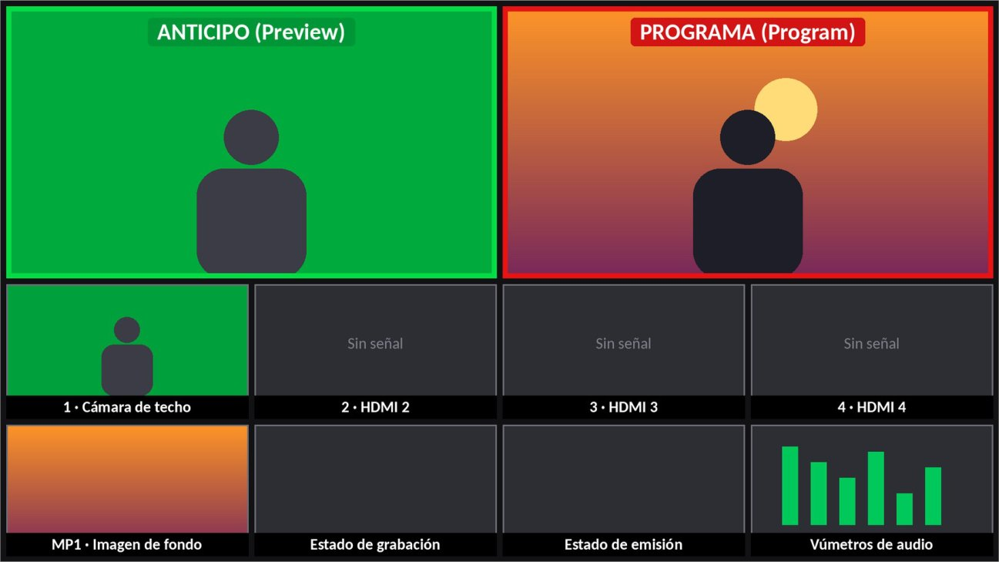{ width="750" }

*Figura 1. Esquema orientativo de la multivista (M/V) del ATEM Mini Pro.*

| | Descripción |
|---|---|
| **A** | **Anticipo** (recuadro verde): la siguiente imagen que saldrá. Aquí comprobamos el croma antes de emitirlo. |
| **P** | **Programa** (recuadro rojo): la imagen final que se graba o se emite. |
| **1–4** | Entradas HDMI 1 a 4. La 1 es la cámara de techo que enfoca el croma. |
| **MP1** | Reproductor multimedia: la imagen de fondo, además del estado de grabación, emisión y vúmetros de audio. |

!!! tip "Cómo se controlan"
    En el software, la fila superior de botones (**Programa**) cambia directamente lo que está en el aire; la fila inferior (**Anticipo**) prepara la siguiente fuente. En la consola física, los botones grandes **1, 2, 3 y 4** cambian la fuente en Programa al instante (el que está en rojo es el que sale), y **CUT/AUTO** lanzan la transición.

## 3. Puesta en marcha { .seccion }

### Paso 1. Encender la iluminación del croma

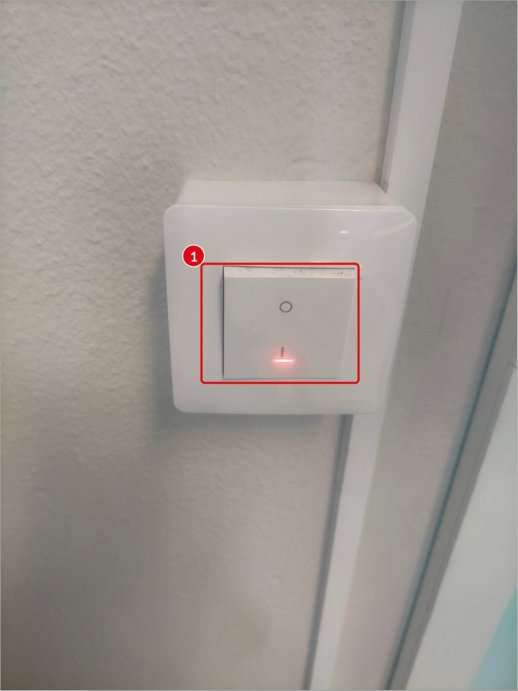{ width="260" }

Junto al plóter hay un interruptor de pared que controla la luz de los proyectores que iluminan el área del croma.

| | Descripción |
|---|---|
| **1** | Pulsar el interruptor en la posición **I**. El piloto rojo queda encendido. |

Una iluminación **uniforme** del fondo verde, sin sombras ni zonas oscuras, es la clave de un buen croma. Conviene que la persona se coloque a cierta distancia del fondo para no proyectar su sombra sobre él.

*Figura 2. Interruptor de la luz de los proyectores.*

### Paso 2. Encender el alargador de la consola

La ATEM Mini Pro recibe corriente a través de un alargador (base de enchufes Nanocable) que está en el suelo, junto al zócalo del croma. Activamos su interruptor: se iluminan los botones de la consola y el botón **1** se pone en rojo.

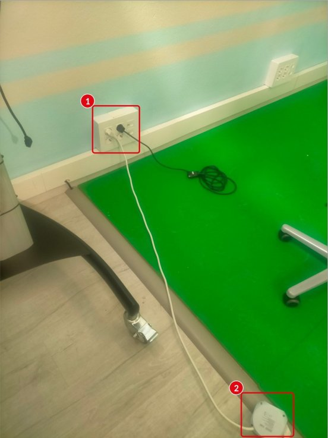{ width="280" }

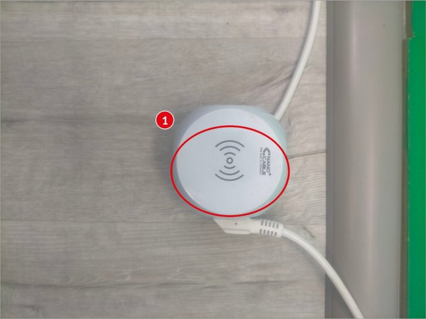{ width="360" }

*Figura 3. Toma de pared y recorrido del cable. · Figura 4. Alargador que alimenta la ATEM Mini Pro.*

| | Descripción |
|---|---|
| **1** | Toma de pared donde está enchufado el alargador (cable blanco). |
| **2** | Alargador en el suelo, junto al zócalo del croma. |

### Paso 3. Encender el portátil

Encendemos el portátil **ASUS** e iniciamos sesión. Todavía no hace falta abrir ningún programa: primero revisaremos las conexiones.

## 4. Conexiones de la ATEM Mini Pro { .seccion }

Todas las conexiones están en la parte trasera de la consola. Por defecto, la cámara de techo ya está conectada a **HDMI 1** y el portátil y la ATEM ya están unidos por el **cable USB blanco**. Antes de empezar, comprobamos que todo está en su sitio:

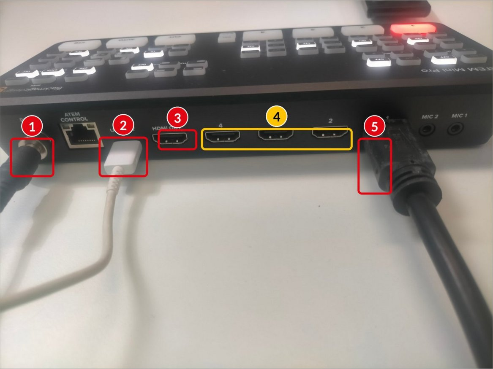{ width="700" }

*Figura 5. Panel trasero de la ATEM Mini Pro.*

| | Descripción |
|---|---|
| **1** | **POWER**: alimentación de la consola (viene del alargador). |
| **2** | **USB OUT**: cable blanco hacia el portátil. Por aquí el software controla la ATEM y el portátil la reconoce además como «webcam». |
| **3** | **HDMI OUT**: salida hacia la pantalla. Aquí conectamos el cable HDMI largo del Aula ATECA. |
| **4** | **HDMI 2, 3 y 4**: entradas libres para otras fuentes (otra cámara, un segundo portátil…). |
| **5** | **HDMI 1**: entrada de la cámara de techo. Es la fuente **CAM1** del software. |

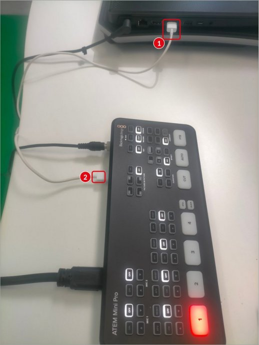{ width="260" }

| | Descripción |
|---|---|
| **1** | Puerto USB del portátil con el cable blanco conectado. |
| **2** | Otro extremo del mismo cable, en el puerto **USB OUT** de la ATEM. |

!!! warning "Si el software no detecta la consola"
    Lo primero es comprobar este cable USB en **ambos extremos**.

*Figura 6. El cable USB blanco une la ATEM con el portátil.*

### Paso 4. Conectar la pantalla y seleccionar la entrada

1. Conectamos un extremo del cable HDMI largo (está en el Aula ATECA) al puerto **HDMI OUT** de la ATEM.
2. Conectamos el otro extremo a un puerto HDMI de la pantalla o televisor. Nos fijamos en qué puerto lo colocamos (HDMI 1, HDMI 2…).
3. Encendemos la pantalla y, con su propio mando, pulsamos **Fuente / Input / Source** y elegimos ese puerto HDMI.
4. Veremos la multivista con el Anticipo y el Programa (apartado 2).

!!! note
    Si solo se ve una imagen a pantalla completa en lugar de los cuadrantes, pulsamos el botón **M/V** de la consola (apartado 7).

## 5. Encuadre de la cámara con el mando { .seccion }

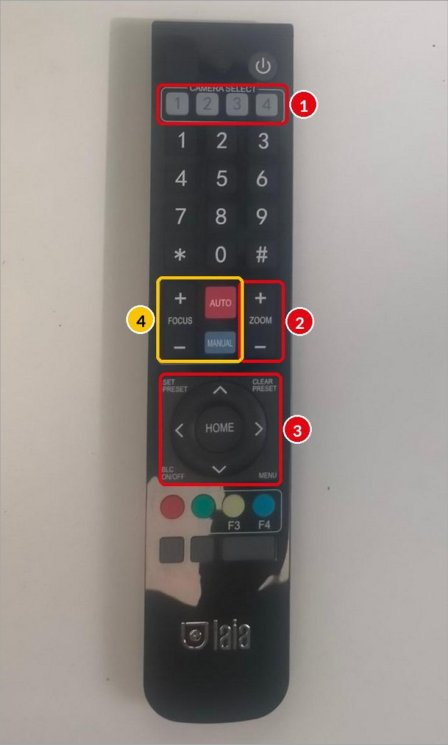{ width="220" }

La cámara de techo es motorizada y se controla con su mando. Nos colocamos delante de ella y la apuntamos con el mando, como si fuera un televisor.

| | Descripción |
|---|---|
| **1** | **CAMERA SELECT**: comprobamos que está seleccionada la cámara 1. |
| **2** | **ZOOM + / −**: acercamos o alejamos hasta que el croma ocupe todo el encuadre. |
| **3** | **Flechas**: desplazan la cámara. **HOME** la devuelve a la posición central. |
| **4** | **FOCUS**: se recomienda dejar el enfoque en **AUTO**. |

*Figura 7. Mando de la cámara de techo.*

!!! warning "Objetivo del encuadre"
    Que **no se vea nada que no sea verde** (ni paredes, ni suelo, ni el zócalo). Todo lo que no sea verde no se eliminará y aparecerá encima del fondo.

## 6. Configuración en ATEM Software Control { .seccion }

### Paso 5. Abrir el programa

En el portátil abrimos **ATEM Software Control** con el icono anclado en la barra de tareas (icono rojo-anaranjado). La interfaz imita a la consola física: todo lo que pulsemos en pantalla se refleja en la consola y viceversa.

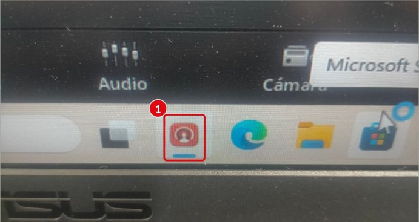{ width="420" }

*Figura 8. Icono de ATEM Software Control en la barra de tareas (1).*

### Paso 6. Seleccionar Programa y Anticipo

En la pestaña **Mezclador** (abajo) vemos dos filas de botones: la de arriba es **Programa** y la de abajo es **Anticipo**.

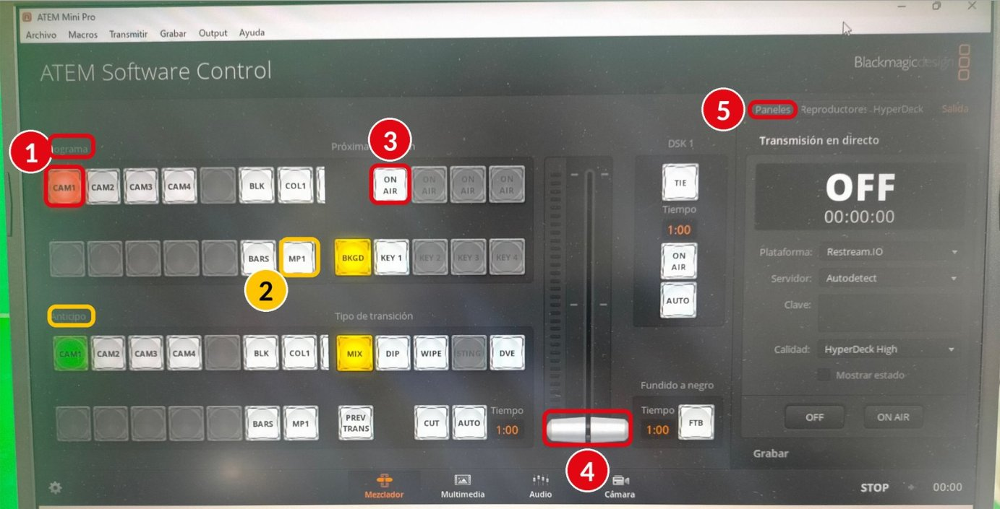{ width="800" }

*Figura 9. Pantalla principal (Mezclador) de ATEM Software Control.*

| | Descripción |
|---|---|
| **1** | En **Programa** pulsamos **CAM1** (se pone en rojo). CAM1 es la cámara de techo (HDMI 1). |
| **2** | En **Anticipo** pulsamos **MP1** (reproductor multimedia: la imagen de fondo). |
| **3** | Botón **ON AIR** de **KEY 1**: activa la composición del croma en el aire (paso 8). |
| **4** | **Deslizador de transición**: pasa el Anticipo a Programa (paso 8). |
| **5** | Pestaña **Paneles** del menú de la derecha, donde se configura el croma (paso 7). |

!!! tip
    Se pueden usar otras fuentes conectándolas a HDMI 2, 3 y 4 (botones CAM2, CAM3 y CAM4): otra cámara o incluso un PC reproduciendo un vídeo, que también podría servir de fondo del croma.

### Paso 7. Configurar el efecto de croma

En el menú de la derecha abrimos **Paneles** y buscamos el bloque **Composición previa 1** (la llave o *key* 1 de la consola).

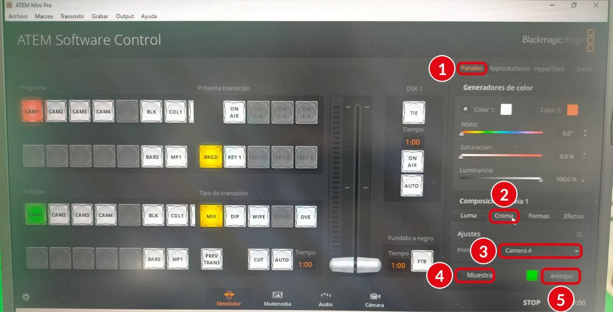{ width="800" }

*Figura 10. Panel «Composición previa 1» con la pestaña Croma.*

| | Descripción |
|---|---|
| **1** | Pestaña **Paneles**. |
| **2** | Pestaña **Croma** dentro de «Composición previa 1». |
| **3** | Desplegable **Primer plano**: elegimos **Camera 1**. En la foto aparece Camera 4; hay que cambiarlo a Camera 1, que es la cámara de techo. |
| **4** | Botón **Muestra**: toma una muestra del color verde. |
| **5** | Botón **Anticipo**: permite ver el resultado antes de sacarlo al aire. |

Con *Primer plano* en **Camera 1**, pulsamos **Muestra** y después **Anticipo**. Así la ATEM toma una muestra del color del fondo para saber qué tiene que eliminar.

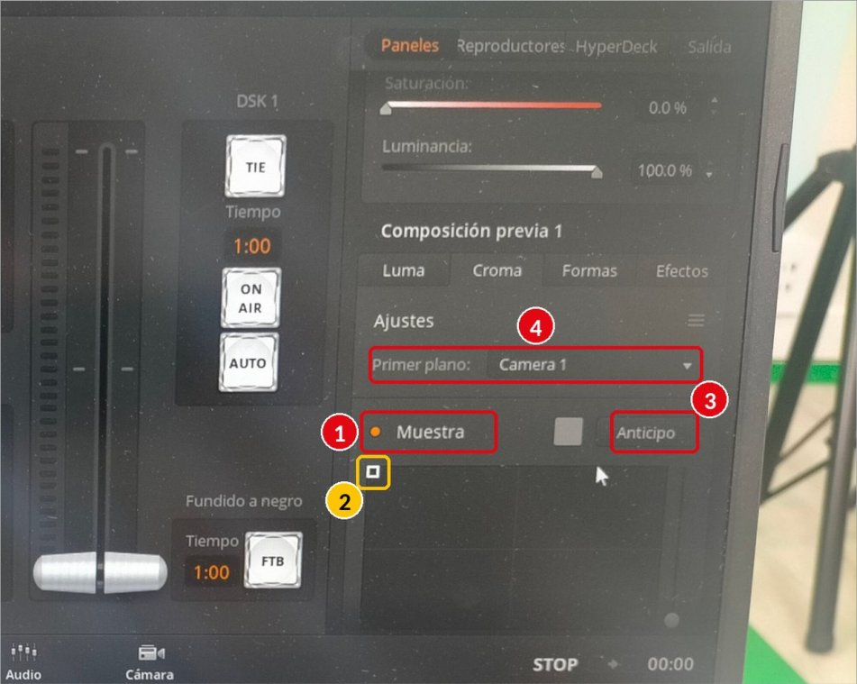{ width="600" }

*Figura 11. Muestreo del color con Primer plano en Camera 1.*

| | Descripción |
|---|---|
| **1** | **Muestra** activada (el punto se vuelve naranja). |
| **2** | Recuadro de muestreo: se coloca sobre una zona verde bien iluminada. |
| **3** | Botón **Anticipo**. |
| **4** | **Primer plano**: Camera 1 ya seleccionado. |

!!! tip "Ajuste fino"
    Si quedan bordes verdes o zonas que parpadean, retoca los deslizadores de **Composición → Primer plano** y **Fondo**, o repite la muestra en otra zona del verde. Hacer los ajustes con la persona ya colocada delante del fondo da mejores resultados.

### Paso 8. Activar el croma: ON AIR y deslizador

1. Pulsamos el botón **ON AIR** que está sobre **KEY 1** en «Próxima transición» (número 3 de la figura 9). La composición de croma queda activa en el aire.
2. Movemos el **deslizador de transición** (número 4) hasta el otro extremo, o pulsamos **AUTO**.
3. La imagen MP1 pasa a Programa como fondo y la cámara 1, sin el verde, queda superpuesta encima. **¡Ya tenemos el croma funcionando!**

!!! info
    Es el mismo funcionamiento de un estudio de televisión: se prepara todo en Anticipo, se comprueba y, cuando está listo, se lanza a Programa con una transición.

### Paso 9. Poner las imágenes de fondo

Las imágenes de fondo se cargan en la pestaña **Multimedia** (abajo). La ATEM las guarda en su memoria interna y el reproductor **MP1** muestra la que elijamos.

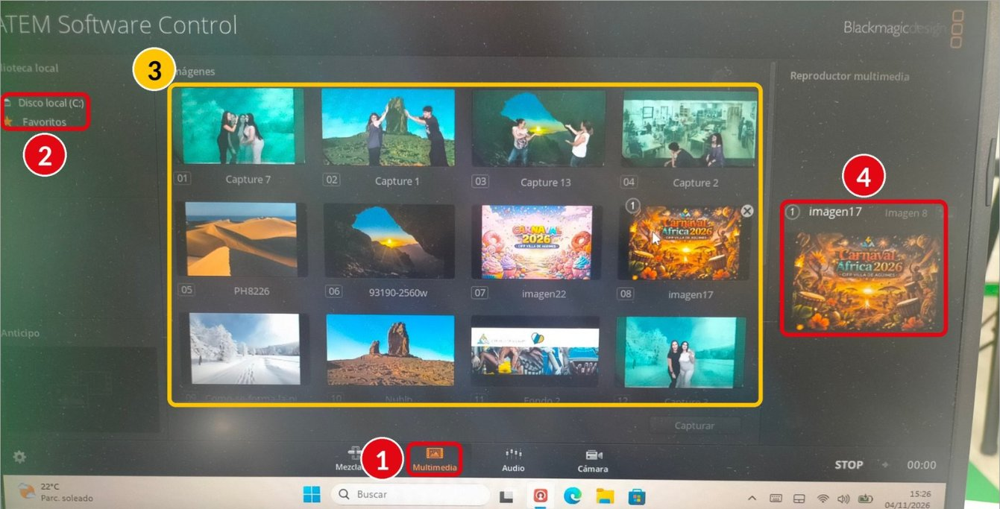{ width="800" }

*Figura 12. Pestaña Multimedia con la biblioteca de imágenes.*

| | Descripción |
|---|---|
| **1** | Pestaña **Multimedia**. |
| **2** | **Biblioteca local**: navegamos por el disco del portátil (Disco local C:) hasta la carpeta con las imágenes. |
| **3** | **Imágenes de la ATEM**: arrastramos la imagen hasta una casilla libre (o encima de una que queramos sustituir). |
| **4** | **Reproductor multimedia**: elegimos la imagen que mostrará MP1. La seleccionada lleva el número 1 en su miniatura. |

- **Formato recomendado**: 1920 × 1080 píxeles (16:9), en JPG o PNG, para que el fondo no se vea deformado ni pixelado.
- El botón **Capturar** guarda como imagen el fotograma que hay en ese momento en Programa.
- Para **cambiar de fondo** durante la grabación basta con elegir otra imagen en el reproductor multimedia: el cambio se ve al instante.

## 7. Manejo desde la consola física { .seccion }

Una vez configurado el croma con el software, la consola permite trabajar sin tocar el portátil:

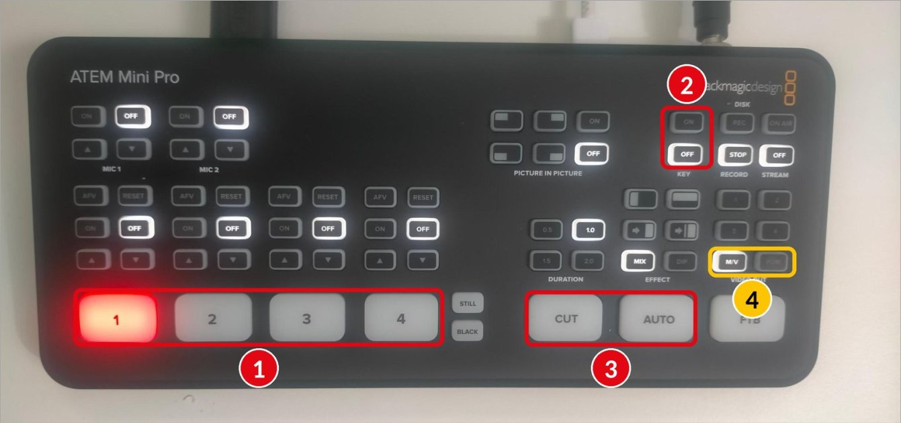{ width="800" }

*Figura 13. Panel frontal de la ATEM Mini Pro.*

| | Descripción |
|---|---|
| **1** | Botones **1, 2, 3 y 4**: cambian la fuente que sale en Programa. El que está en rojo es el que está en el aire. |
| **2** | **KEY ON / OFF**: activa o desactiva el croma (equivale al ON AIR de KEY 1 del software). |
| **3** | **CUT** (corte seco) y **AUTO** (transición suave con la duración elegida, p. ej. 1,0 s). |
| **4** | **VIDEO OUT**: decide qué se ve en la pantalla. **M/V** muestra la multivista y **PGM** solo el Programa (la composición final a pantalla completa). |

!!! note
    Los botones 1 a 4 de **VIDEO OUT**, encima de PGM, muestran a pantalla completa cada entrada por separado.

## 8. Resumen rápido { .seccion }

| Nº | Acción | Dónde |
|---|---|---|
| 1 | Encender la luz de los proyectores | Interruptor de pared junto al plóter |
| 2 | Encender el alargador de la ATEM | Suelo, junto al zócalo del croma |
| 3 | Encender el portátil | Mesa de control |
| 4 | Comprobar HDMI 1 (cámara) y USB blanco (portátil) | Parte trasera de la ATEM |
| 5 | Conectar HDMI OUT a la pantalla y elegir su entrada | Cable HDMI largo del Aula ATECA |
| 6 | Encuadrar el croma con zoom y flechas | Mando de la cámara de techo |
| 7 | Abrir ATEM Software Control | Icono rojo-anaranjado de la barra de tareas |
| 8 | Programa: CAM1 · Anticipo: MP1 | Pestaña Mezclador |
| 9 | Croma → Primer plano: Camera 1 → Muestra → Anticipo | Paneles → Composición previa 1 |
| 10 | ON AIR de KEY 1 y deslizador (o AUTO) | Pestaña Mezclador |
| 11 | Cargar y elegir la imagen de fondo | Pestaña Multimedia |

## 9. Problemas frecuentes { .seccion }

| Problema | Posible solución |
|---|---|
| La pantalla no muestra imagen | Revisar el cable en HDMI OUT y que la pantalla tenga seleccionado el puerto HDMI correcto. |
| El software no encuentra la ATEM | Comprobar el cable USB blanco en los dos extremos y que la consola esté encendida (alargador activado). |
| Se ven paredes o suelo encima del fondo | Reencuadrar con el mando (zoom y flechas) hasta que solo se vea verde. |
| Quedan bordes verdes o el recorte parpadea | Mejorar la iluminación, repetir la Muestra y ajustar los deslizadores de Primer plano y Fondo. |
| La persona «desaparece» en parte | No usar ropa verde ni objetos verdes o muy brillantes. |
| Solo se ve una imagen, no los cuadrantes | Pulsar **M/V** en VIDEO OUT de la consola. |
| El fondo no cambia | Comprobar en Multimedia qué imagen tiene asignada el reproductor MP1. |

## 10. Apagado { .seccion }

1. Cerrar **ATEM Software Control** y apagar el portátil.
2. Desactivar el interruptor del **alargador** (se apaga la ATEM).
3. Apagar la **luz de los proyectores** en el interruptor de pared.
4. Desconectar el **cable HDMI largo** y devolverlo al Aula ATECA.
